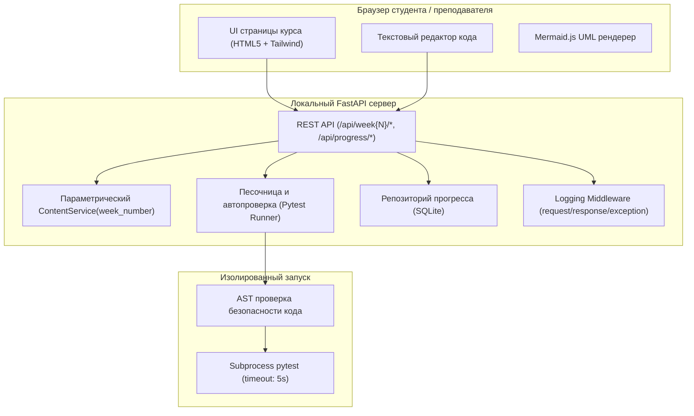

# Архитектура веб-платформы Web OOP (Мини-LMS)

## 1. Обзор системы и цели

Веб-платформа **Web OOP** — это локальная образовательная среда (мини-LMS) для интерактивного изучения ООП студентами второго курса КазНУ.
Система позволяет:
- Изучать структурированные материалы курса (3 недели: Основы ООП → SOLID → Паттерны GoF).
- Исследовать интерактивные UML-диаграммы классов и жизненного цикла объектов.
- Проходить тесты на понимание концепций и ловушек ООП.
- Писать и проверять код решений прямо в браузере с мгновенным локальным запуском автотестов (`pytest`).
- Накапливать баллы за пройденные модули и финальный экзамен.

## 2. Технологический стек

Выбор стека ориентирован на максимальное удобство и прозрачность для ИИ-агентов (AI-legibility) и простоту локального запуска:
- **Бэкенд:** Python 3.12+ / FastAPI / Uvicorn
  - Строгая типизация через Pydantic.
  - Встроенная спецификация OpenAPI / Swagger (`http://localhost:8000/docs`).
  - Чистая компонентная архитектура без лишней магии.
- **Фронтенд:** Нативный HTML5 + Tailwind CSS (CDN) + Vanilla JS (ES-модули) + Mermaid.js
  - **Zero build step:** Нет `node_modules`, `webpack`, `vite`, `npm install` — фронтенд готов к работе мгновенно.
  - **Динамический рендеринг диаграмм:** Mermaid.js рендерит диаграммы классов и последовательностей прямо в браузере.
- **Тестирование и линтинг:**
  - `pytest` — запуск как тестов платформы, так и студенческих заданий.
  - `ruff` — сверхбыстрый статический анализ и проверка стиля кода.
- **Хранилище данных:**
  - Локальный файл `data/state.json` или SQLite — персистентность прогресса студентов и баллов без внешних СУБД.

## 3. Схема архитектуры



## 4. Безопасность локальной проверки кода

1. **AST-валидация:** код студента перед запуском парсится модулем `ast`. Запрещены импорты опасных модулей (`subprocess`, `shutil`, `socket`) и деструктивные операции.
2. **Изолированный subprocess:** тесты запускаются в отдельном процессе с ограничением времени выполнения (`timeout=5`). Бесконечные циклы студента прерываются автоматически без падения веб-сервера.
3. **Структурированный ответ:** бэкенд возвращает статус `passed/failed`, список тестов, лог вывода и начисленные баллы.

## 5. Модули учебного контента и REST API

### Архитектура контента (`content/week{N}/`)
- `lecture.json` — структурированные разделы лекций (теория + SVG Mermaid схемы классов и последовательностей).
- `quiz.json` — банк вопросов с вариантами, баллами и объяснениями. Правильные ответы маскируются на бэкенде.
- `practice.json` — лабораторные задания, список инвариантов, стартовый код и тестовые наборы `pytest`.

### Параметрический ContentService (`app/services/content_service.py`)
Единый `ContentService(week_number)` обслуживает все недели. Экземпляры кешируются через `@lru_cache`. Загружает JSON из `content/week{N}/`.

### Shared-модули API
- `app/api/deps.py` — shared FastAPI-зависимости (`get_or_create_student`).
- `app/api/schemas.py` — shared Pydantic-модели запросов и ответов.

### Эндпоинты модулей недель (`app/api/week1.py`, `app/api/week2.py`)
- `GET /api/week{N}/lecture` — получение текста лекции и UML-схем.
- `GET /api/week{N}/quiz` — получение списка вопросов (без раскрытия правильных ответов).
- `POST /api/week{N}/quiz/submit` — проверка ответов студента, сохранение баллов в `TopicProgress`.
- `GET /api/week{N}/practice` — получение условий, инвариантов и стартового шаблона кода.
- `POST /api/week{N}/practice/submit` — безопасный запуск решения в песочнице `RunnerService`, запись в `Submission`. Ответ содержит `current_score` (результат текущего запуска) и `best_score` (лучший сохранённый), а также legacy-поле `score` для обратной совместимости.
- `GET /api/week{N}/progress` — расчет суммарных баллов студента за неделю.

### Прочитанность лекций
- `POST /api/week{N}/lecture/mark-read` — идемпотентная отметка прочитанности лекции (модель `LectureRead`).
- `GET /api/week{N}/lecture/read-status` — получение статуса прочитанности.

### Подсистема прогресса (`app/api/progress.py`)
- `GET /api/progress/summary?username=...` — агрегированная сводка баллов по всем неделям (quiz, practice, lecture_read per week + total_score, total_max, completion_percent).
- `GET /api/progress/export?username=...` — компактный JSON для экспорта (copy-paste в Telegram).

### Персистентность данных (SQLite)
Таблицы SQLAlchemy в `data/web_oop.db`:
- `students`: идентификатор студента, имя, группа.
- `topic_progress`: накопленные баллы по темам и компонентам (quiz, practice) с сохранением наивысшего результата (High Watermark).
- `submissions`: история попыток с кодом решения, статусом выполнения и консольным логом pytest.
- `lecture_reads`: отметки прочитанности лекций по неделям (`student_id`, `week_number`, `read_at`).

### Logging Middleware (`app/main.py`)
Middleware логирует request method/path, response status, duration. При unhandled exception — полный traceback в stdout.

## 6. Запуск платформы

```bash
# Установка зависимостей (при наличии uv или pip)
uv pip install -e .

# Запуск сервера
python -m uvicorn app.main:app --port 8000
```
Сайт доступен локально: `http://localhost:8000`.
