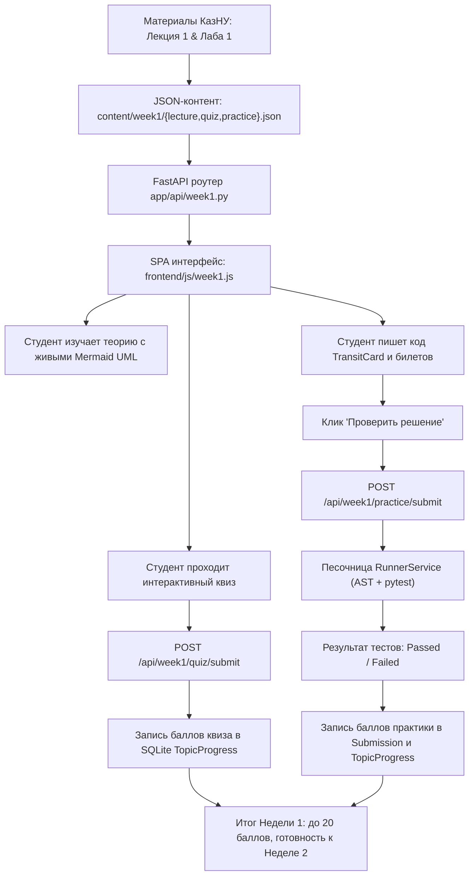

# HL — OOP_20261014-133501_W1MAT: Наполнение платформы практическими материалами Недели 1: основы ООП, инкапсуляция и защита инвариантов

> **Current filename**: `HL-OOP_20261014-133501_W1MAT.md`  
> **Date**: 2026-10-14  
> **Author**: saubakirov  
> **Title**: Наполнение платформы практическими материалами Недели 1: основы ООП, инкапсуляция и защита инвариантов  
> **Abbreviation**: W1MAT  
> **Status**: 📝 HL_APPROVED  
> **Contract**: 🔒 FROZEN — approved by saubakirov 2026-10-14  
> **Frozen**: §1 · §3 · §4 · §5 · §6 · §7 — locked on owner approval  
> **Free**: §2 · §7.2 · §8 · §9 · §10 · §11 — research updates these directly  
> **Append-only**: §12 Amendment Log — the only channel for changing a frozen section  
> **Baseline**: freeze commits — recovery form in `conventions.md` §3 rule 15  
> **Project North Star**: `README.md #ns1 · #ns2 · #ns3`  

---

## 1. Vision 🔒 FROZEN

Платформа Web OOP трансформируется из базового технического каркаса в полноценную интерактивную среду обучения: для Недели 1 курса («Основы ООП и защита инвариантов») развернуты структурированные теоретические материалы с живыми UML-диаграммами классов и последовательностей (Mermaid.js), интерактивный проверочный квиз с мгновенной валидацией концепций, и онлайн-практикум с автоматической проверкой кода студентов через изолированный RunnerService. Студенты второго курса КазНУ изучают проектирование Rich Domain Model на понятном прикладном домене алматинского транспорта Avtobys, реализуют защиту инвариантов сущностей `TransitCard` и `SingleTripTicket` и получают прозрачные баллы (до 20 баллов за неделю) с автоматическим сохранением прогресса в локальной базе данных SQLite.

**Impact:** Завершен переход от инфраструктурной заготовки к реальному учебному процессу. Студенты получают автономный интерактивный тренажер без необходимости настройки локального окружения, преподаватель видит надежную систему автооценивания, а платформа формирует эталонный формат для последующих модулей 2-й и 3-й недель курса.

> *«Студентам больше не нужно пересылать скрипты в мессенджерах или гадать, почему float ломает расчет баланса. Они открывают Неделю 1, видят живые схемы инкапсуляции, проходят квиз на выявление антипаттернов и тут же в веб-интерфейсе пишут класс транспортной карты, проверяя защиту инвариантов через автотесты pytest за пару секунд».*

---

## 2. Current State (As-Is) 🟢 FREE

1. **Фундамент платформы (результат задачи `OOP_20261009-123309_PFBZ`):**
   - Бэкенд на FastAPI (`app/main.py`) с CORS, раздачей статики и проверкой работоспособности (`/api/health`).
   - SQLite база данных (`data/web_oop.db`) со схемой SQLAlchemy: модели `Student`, `TopicProgress`, `Submission`.
   - Сервис `RunnerService` (`app/services/runner.py`) с AST-валидацией безопасности и изолированным запуском `pytest` в `tempfile.TemporaryDirectory` с таймаутом 5 секунд.
   - Zero-build фронтенд (`frontend/index.html`, `js/app.js`, Tailwind CSS CDN, Mermaid.js CDN).
2. **Узкие места и пробелы:**
   - Эндпоинт `/api/course/overview` отдает фиксированный JSON-каркас, где тема `w1-t1` имеет статус `is_ready: True` только номинально: самого учебного контента (теории, формулировок задач, тестов) нет.
   - Отсутствуют эндпоинты выдачи лекционного материала, вопросов квиза и проверки практических заданий Недели 1.
   - Пользовательский интерфейс не содержит навигации по этапам недели (Теория / Квиз / Практика) и редактора кода для выполнения студенческих заданий.
3. **Методическая основа кафедры:**
   - В распоряжении проекта имеются оригинальные файлы КазНУ CS2203 (`G:\My Drive\AgentSharedFolder\KazNU\OOP`):
     - `01_Лекции/Лекция_01_От_процедурного_подхода_к_объектам_Инкапсуляция.pdf`
     - `02_Лабораторные/Лабораторная_01_Моделирование_домена_Avtobys_Защита_инвариантов.pdf`
     - Силлабус и учебный план в `docs/course_curriculum.md` (20 баллов за Неделю 1).

---

## 3. Target State (To-Be) 🔒 FROZEN

Реализовать комплексный интерактивный модуль Недели 1 со следующей архитектурой:

1. **Слой данных учебного контента (`content/week1/`):**
   - `content/week1/lecture.json`:
     - Текст и структура лекции 1: «От процедурного подхода к объектам. Инкапсуляция и защита инвариантов».
     - 5 ключевых тем: 1) Проблемы процедурного словаря и размытие логики; 2) Классы и экземпляры в Python 3.12; 3) Инкапсуляция (`@property`, скрытие `_balance`, `_is_blocked`); 4) Защита инвариантов на примере Avtobys (`Decimal` против `float`, запрет отрицательного баланса, блокировка, минимальное пополнение 100 KZT); 5) Принцип «Tell, Don't Ask» и антипаттерн Anemic Domain Model.
     - Интерактивные диаграммы Mermaid.js: `classDiagram` доменных сущностей и `sequenceDiagram` валидации проезда.
   - `content/week1/quiz.json`:
     - 6 структурированных тестовых вопросов с вариантами ответов, разъяснениями (explanation) и весами (суммарно 10 баллов).
   - `content/week1/practice.json`:
     - Описание практической лабораторной работы 1: моделирование `TransitCard` и `SingleTripTicket` с защитой инвариантов.
     - Стартовый шаблон кода с аннотациями типов и docstrings.
     - Эталонный тестовый сьют `test_domain_w1.py` на базе `pytest`, проверяющий все критические инварианты (баланс, блокировка, исключения `InsufficientFundsError`, `CardBlockedError`, `TicketAlreadyUsedError`, `TicketExpiredError`).
     - Разбалловка практики: 10 баллов за 100% pass в автотестах. Общий балл за неделю = 20 баллов.

2. **Бэкенд сервисы и API (`app/api/week1.py`, `app/services/content_service.py`):**
   - `GET /api/week1/lecture`: выдача структурированной лекции и схем Mermaid.
   - `GET /api/week1/quiz`: выдача вопросов теста (без раскрытия верных ответов).
   - `POST /api/week1/quiz/submit`: валидация ответов студента, расчет баллов (до 10), формирование фидбека и сохранение прогресса в `TopicProgress`.
   - `GET /api/week1/practice`: получение условий практики, сигнатур классов и стартового шаблона решения.
   - `POST /api/week1/practice/submit`: отправка студенческого кода в `RunnerService`, прогон через эталонный тестовый сьют, фиксация попытки в таблице `Submission` и сохранение набранных баллов в `TopicProgress`.
   - `GET /api/week1/progress`: агрегированный статус прохождения недели студентом (баллы за квиз, баллы за практику, суммарный результат X/20).

3. **Интерактивный Zero-Build интерфейс (Single Page Application в `frontend/`):**
   - Навигационный переход: выбор Недели 1 в шапке или на карточке открывает динамический учебный дашборд Недели 1 с сохранением системного статус-бара.
   - Вкладки модуля Недели 1:
     - **Вкладка «📖 Лекция»**: структурированное чтение с живыми блоками кода и авторендерингом Mermaid UML-диаграмм.
     - **Вкладка «❓ Проверочный квиз»**: интерактивный опросник, мгновенная проверка ответов, показ разбора правильных решений и начисление баллов (до 10).
     - **Вкладка «💻 Практикум»**: формулировка задачи, требования к инвариантам, удобный редактор кода, кнопка «▶ Проверить решение», индикатор выполнения и форматированный консольный лог вывода `pytest` из песочницы с начислением баллов (до 10).
     - Общий индикатор успеваемости недели: бейдж `Прогресс: X / 20 баллов` с сохранением состояния в БД.

4. **Автоматическое тестирование и гарантия качества:**
   - Тесты API `tests/test_api_week1.py` (все эндпоинты Недели 1).
   - Интеграционный тест `tests/test_content_week1.py` (валидность JSON-контента, проверка эталонного решения через `RunnerService` на 100% pass).
   - Линтинг `ruff check .` без замечаний.

---

### 3.1 Result Visualization

```text
Браузер студента: http://localhost:8000/ (Раздел: Неделя 1)
┌────────────────────────────────────────────────────────────────────────────────────────┐
│ 🎓 Web OOP — КазНУ CS2203   [← К обзору курса]  [Неделя 1: Активна]    [Баллы: 20/20]  │
├────────────────────────────────────────────────────────────────────────────────────────┤
│ 🟢 Бэкенд: Активен | SQLite: Connected | Раннер: Готов                                 │
├────────────────────────────────────────────────────────────────────────────────────────┤
│ ┌────────────────────────────────────────────────────────────────────────────────────┐ │
│ │ Вкладки: [ 📖 1. Лекция ]   [ ❓ 2. Квиз (10 б.) ]   [ 💻 3. Практикум (10 б.) ]   │ │
│ └────────────────────────────────────────────────────────────────────────────────────┘ │
│                                                                                        │
│ ▼ АКТИВНА ВКЛАДКА «3. Практикум: Моделирование сущностей Avtobys»                      │
│                                                                                        │
│ ┌────────────────────────────────────────┐ ┌─────────────────────────────────────────┐ │
│ │ 📋 Условия задачи и инварианты         │ │ 💻 Редактор решения (Python 3.12)       │ │
│ │                                        │ │                                         │ │
│ │ Реализуйте класс TransitCard:          │ │ from decimal import Decimal             │ │
│ │ 1. Баланс >= 0 (Decimal)               │ │                                         │ │
│ │ 2. Пополнение >= 100 KZT               │ │ class TransitCard:                      │ │
│ │ 3. Заблокированная карта не платит     │ │     def __init__(self, card_id, ...):   │ │
│ │ 4. Исключение InsufficientFundsError   │ │         ...                             │ │
│ │                                        │ │     def pay(self, fare: Decimal):       │ │
│ │ [Скачать шаблон tests/test_domain.py]  │ │         ...                             │ │
│ └────────────────────────────────────────┘ └─────────────────────────────────────────┘ │
│                                                                                        │
│ ┌────────────────────────────────────────────────────────────────────────────────────┐ │
│ │ [ ▶ Запустить автопроверку через RunnerService ]              [ Статус: ✅ 10/10 ] │ │
│ ├────────────────────────────────────────────────────────────────────────────────────┤ │
│ │ 📟 Вывод песочницы pytest:                                                         │ │
│ │ tests/test_w1.py::test_card_prevents_negative_balance PASSED                       │ │
│ │ tests/test_w1.py::test_card_blocked_rejects_operations PASSED                      │ │
│ │ tests/test_w1.py::test_ticket_double_validation PASSED                             │ │
│ │ ============================== 5 passed in 0.42s ================================= │ │
│ └────────────────────────────────────────────────────────────────────────────────────┘ │
└────────────────────────────────────────────────────────────────────────────────────────┘
```

---

### 3.2 Value Flow



---

## 4. Phases 🔒 FROZEN

Задача является связной и выполняется как **единая фаза (Single-phase task)**:

- **Phase A (Single-phase):** Наполнение Недели 1 (Контент, API, Интерактивный UI, Автопроверка и Тесты).
  - **Приоритет:** 🔴 High
  - **Deliverables:**
    1. Каталог контента `content/week1/` (`lecture.json`, `quiz.json`, `practice.json`, тестовый сьют `test_domain_w1.py`).
    2. Бэкенд-сервис `app/services/content_service.py` и API-роутер `app/api/week1.py` с полной регистрацией в `app/main.py`.
    3. Обновленный фронтенд: дашборд Недели 1 с табами (Лекция, Квиз, Практикум), редактором кода и панелью автопроверки.
    4. Интеграция с БД SQLite: сохранение баллов за квиз и практику в `TopicProgress` и попыток в `Submission`.
    5. Автотесты в `tests/test_api_week1.py` и `tests/test_content_week1.py` со 100% прохождением и чистым `ruff`.

### 4.1 Coordination Selection 🔒 FROZEN

| Источник активации | Ответственный владелец | Координатор задачи | Правило координатора фазы | Охват ролей / мандат | Upward route | Диалог | Репортинг | Ограничения и резервирования | Полномочия правок | Неизменяемая эпоха |
|---|---|---|---|---|---|---|---|---|---|---|
| `owner-direct` | `saubakirov` | `antigravity:thread:local:52848fc1-8c1a-49c8-80b7-f1971934045f` | `none` (однофазная задача) | task Coordinator: HL/TS; Executor: handoff; Reviewer: review | `owner:saubakirov` | `tfw-gates-only` | `native-gates` | Владелец утверждает HL, TS, ключевые изменения скоупа и итоговое закрытие | `none` | baseline |

*Примечание к координации:* Выбран **Visible full-chat route**: для ролей Исполнителя (`/tfw-handoff`) и независимого Ревьюера (`/tfw-review`) владелец открывает отдельные чаты с точной командой активации. Роли возвращают статус и артефакты вертикально Координатору.

---

## 5. Definition of Done (DoD) 🔒 FROZEN

- ✅ 1. Создан структурированный контент Недели 1 в `content/week1/` (полный текст лекции с инвариантами и Anemic/Rich model, квиз на 6-8 вопросов, лабораторная работа с эталонными тестами `test_domain_w1.py`).
- ✅ 2. Реализован бэкенд-модуль `app/api/week1.py` со всеми эндпоинтами лекции, квиза, практики и прогресса.
- ✅ 3. Реализована валидация квиза и автопроверка решений практики через `RunnerService` с фиксацией попыток в `Submission` и прогресса в `TopicProgress`.
- ✅ 4. Создан интерактивный SPA-интерфейс Недели 1 в `frontend/` с переключением табов (Лекция, Квиз, Практикум), рендерингом Mermaid.js, интерактивной формой теста и редактором кода с запуском проверки.
- ✅ 5. Эндпоинт `/api/course/overview` корректно отражает обновленный статус доступности Недели 1.
- ✅ 6. Написаны и успешно проходят тесты `tests/test_api_week1.py` и `tests/test_content_week1.py` (100% pass), проверка `ruff check .` проходит без ошибок.

---

## 6. Definition of Failure (DoF) 🔒 FROZEN

- ❌ 1. Учебный контент содержит заглушки вида `TODO`, `pass`, «текст лекции будет добавлен позже» или неполные описания инвариантов.
- ❌ 2. Квиз или проверка практики не сохраняют заработанные баллы студента в таблицу `TopicProgress` в SQLite.
- ❌ 3. Проверка студенческого кода виснет без таймаута или допускает небезопасное выполнение запрещенных системных команд.
- ❌ 4. В интерфейс добавлены тяжелые Node.js/npm зависимости или сборщики, нарушающие принцип Zero-build.
- ❌ 5. Падают существующие тесты платформы (`test_api_health`, `test_db_models`, `test_runner_service`).

**При сбое:** Немедленная остановка, локализация причины в коде или тестах, откат деструктивных правок через Git, устранение регрессий.

---

## 7. Principles 🔒 FROZEN

1. **Rich Domain Model & Защита инвариантов:** Все доменные сущности транспортной системы (`TransitCard`, `SingleTripTicket`) защищают свои инварианты изнутри, исключая невалидное внешнее состояние.
2. **Zero-Build & Local-First:** Никаких npm/webpack/vite. Фронтенд работает напрямую в браузере студента через нативные ES-модули, Tailwind CDN и Mermaid.js CDN.
3. **Строгая типизация и безопасность:** Использование `Decimal` для финансовых величин, аннотации типов Python 3.12, валидация Pydantic и AST-фильтрация в RunnerService.
4. **Прозрачность оценивания:** Четкая шкала баллов (до 10 за квиз, до 10 за практику = 20 за неделю), понятные сообщения об ошибках и мгновенная обратная связь.

### 7.1 Quality Contract 🔒 FROZEN

- Стиль кода: соответствие PEP 8, проверка линтером `ruff check .`.
- Чистота зависимостей: не добавлять новых зависимостей в `pyproject.toml`, если задача решается стандартной библиотекой Python и текущим окружением.

### 7.2 Knowledge Citations 🟢 FREE

| # | Источник | Элемент | Как применяется в задаче |
|---|---|---|---|
| 1 | `README.md` | North Star NS1 (Интерактивный мини-курс 2-3 недели) | Наполнение первой недели курса интерактивным контентом (1ч лекция + 1ч практика + 1ч автопроверка) |
| 2 | `README.md` | North Star NS2 (AI-friendly, Zero-build, Local-first) | Реализация без npm-сборщиков на чистом HTML5 + Tailwind CDN + Vanilla JS + SQLite |
| 3 | `README.md` | North Star NS3 (Non-goals) | Отказ от сложной микросервисной архитектуры и распределенной авторизации |
| 4 | `.tfw/README.md` | Methodology values | Строгий ролевой лок TFW, проверяемость всех AC, отсутствие плейсхолдеров |
| 5 | `KNOWLEDGE.md` §1 | D1 (Стек: FastAPI, Tailwind CDN, Vanilla JS, Mermaid) | Использование утвержденного стека для дашборда Недели 1 |
| 6 | `KNOWLEDGE.md` §1 | D4 (Персистентность: SQLite models) | Использование таблиц `Student`, `TopicProgress`, `Submission` для сохранения прогресса |
| 7 | `KNOWLEDGE.md` §1 | D6 (RunnerService песочница) | Запуск автотестов лабораторной работы через готовый `RunnerService` с таймаутом 5 сек |

---

## 8. Dependencies 🟢 FREE

| Зависимость | Статус |
|---|---|
| Бэкенд FastAPI и роутинг (`app/main.py`) | ✅ Готов |
| БД SQLite и модели `TopicProgress`, `Submission` (`app/models/course.py`) | ✅ Готов |
| Изолированный сервис запуска тестов `RunnerService` (`app/services/runner.py`) | ✅ Готов |
| Материалы кафедры КазНУ (`G:\My Drive\AgentSharedFolder\KazNU\OOP`) | ✅ Доступны |

---

## 9. Risks 🟢 FREE

| Риск | Вероятность | Влияние | Стратегия смягчения |
|---|---|---|---|
| Перегруз UI при вставке объемного текста лекции | Средняя | Средняя | Структурирование лекции по аккордеонам/разделам с подсветкой кода |
| Студент отправляет код с бесконечным циклом | Высокая | Средняя | `RunnerService` гарантирует прерывание через `timeout=5s` |
| Ошибки рендеринга сложных Mermaid диаграмм на клиенте | Низкая | Низкая | Использование проверенных простых конструкций `classDiagram` и `sequenceDiagram` с fallback на `<pre>` |

---

## 10. RESEARCH Case 🟢 FREE

### Blind Spots
- Специфика форматирования вывода pytest в браузере (подсветка ANSI-цветов или чистый моноширинный текст).

### Hypotheses

| # | Гипотеза | Статус |
|---|---|---|
| H1 | Хранение текстов лекций и тестов в `content/week1/*.json` обеспечивает легкую модификацию курса преподавателем без миграций БД | open |
| H2 | Прогон эталонных тестов `test_domain_w1.py` на коде студента через существующий `RunnerService` укладывается в 1 секунду | open |

### Risks of Not Researching
Риск минимален: архитектура и контракты взаимодействия (`RunnerService`, `FastAPI`, `SQLite`) уже проверены в задаче `PFBZ`. Дополнительного глубокого исследования не требуется, можно переходить к детальной спецификации TS.

### Why Not Just...?

| Подход | Ценность | Нагрузка и сложность | Риски и компромиссы | Решение и обоснование |
|---|---|---|---|---|
| **Рекомендуемый: Интерактивный SPA-модуль Недели 1** (Лекция + Квиз + Практика в RunnerService) | Максимальная: единое окно обучения и автопроверки | Средняя: бэкенд API + Zero-build фронтенд | Необходима четкая верстка редактора кода на Vanilla JS | **Выбран**: полностью соответствует Project North Star |
| **Статический лонгрид со скачиванием архива тестов** | Низкая: нет интерактива | Минимальная | RunnerService не используется, автооценивание отсутствует | **Отклонен** |

**Оставить без изменений:** Платформа остается пустой оболочкой, учебный процесс невозможен.

**Критический вызов:** Проверить, чтобы формат практического задания не требовал избыточного бойлерплейта от студента — предоставить четкий стартовый шаблон классов `TransitCard` и `SingleTripTicket`.

---

## 11. Strategic Insights (Planning) 🟢 FREE

| # | Инсайт | Категория | Источник |
|---|---|---|---|
| S1 | Сквозной домен Avtobys обеспечивает преемственность от Недели 1 к Неделе 3 (от простых инвариантов до Clean Architecture) | Domain / Architecture | Владелец, силлабус КазНУ CS2203 |
| S2 | Формат Zero-build на чистом JS и CDN критически важен для простоты поддержки проекта студентами без возни с node_modules | Tech Constraint | Владелец, North Star NS2 |

---

## 12. Amendment Log 🟢 APPEND-ONLY

**No amendments.**

---

*HL — OOP_20261014-133501_W1MAT: Наполнение платформы практическими материалами Недели 1: основы ООП, инкапсуляция и защита инвариантов | 2026-10-14*
