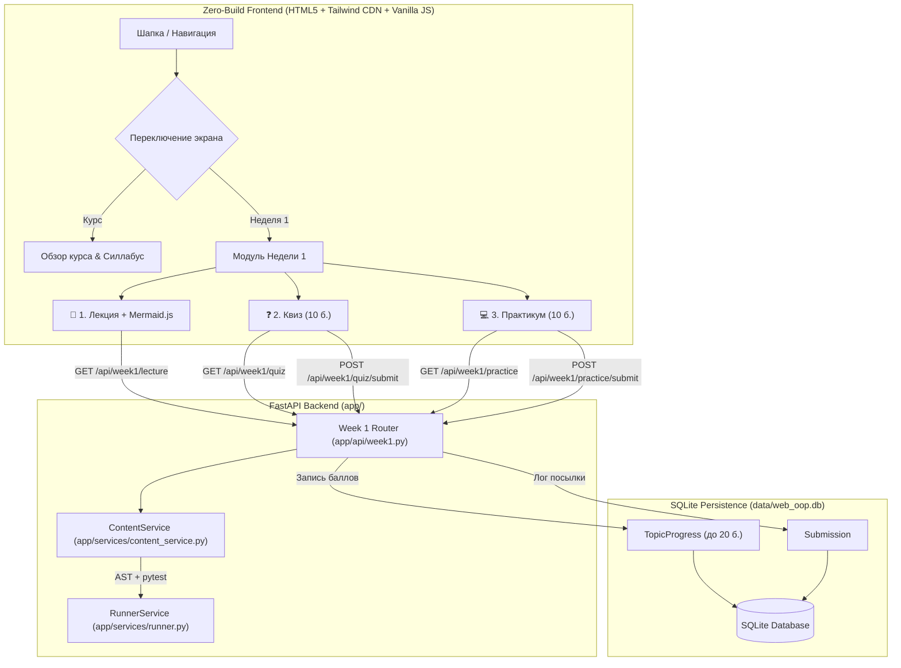

# RF — OOP_20261014-133501_W1MAT: Наполнение платформы практическими материалами Недели 1: основы ООП, инкапсуляция и защита инвариантов

> **Current filename**: `RF__OOP_20261014-133501_W1MAT.md`
> **Date**: 2026-10-14
> **Author**: saubakirov
> **Status**: 🟢 RF — Complete
> **Parent HL**: [HL-OOP_20261014-133501_W1MAT.md](HL-OOP_20261014-133501_W1MAT.md)
> **TS**: [TS__OOP_20261014-133501_W1MAT.md](TS__OOP_20261014-133501_W1MAT.md)
> **Producer unit**: antigravity:thread:local:a1c18544-f89a-4f5a-9ed2-3f396070acd9
> **Parent Coordinator**: antigravity:thread:local:52848fc1-8c1a-49c8-80b7-f1971934045f
> **Activation / dispatch source**: owner-direct: saubakirov
> **Coordination authority**: "HL-OOP_20261014-133501_W1MAT.md @ 79ad355ebf4f3e4c37d34bc2114ab249c38bfb66"
> **Originating proposer**: none
> **Current selection**: reporting: native-gates, selection_ref: baseline
> **Launch observation**: model: Gemini 3.8 Flash (High), effort: default, material rework: none

---

## 1. What Was Done

В рамках выполнения утвержденной спецификации TS по задаче `OOP_20261014-133501_W1MAT` полностью разработан, интегрирован и верифицирован интерактивный учебный модуль Недели 1 («Основы ООП, инкапсуляция и защита инвариантов») на сквозном кейсе платежных инструментов транспортной системы Алматы (`Avtobys`):

1. **Контентный слой (`content/week1/`):**
   - `content/week1/lecture.json`: 5 структурированных разделов лекции (проблемы процедурного подхода, понятие класса и инкапсуляция через `@property`, защита инвариантов и доменные исключения, финансовые расчеты `Decimal` vs `float`, принцип Tell Don't Ask и богатая модель); 2 диаграммы Mermaid.js (`classDiagram` с доменными сущностями и исключениями, `sequenceDiagram` валидации оплаты поездки).
   - `content/week1/quiz.json`: 6 контрольных вопросов с вариантами, баллами (суммарно 10 баллов) и детальными объяснениями логики работы ООП.
   - `content/week1/practice.json`: условия лабораторной работы по проектированию `TransitCard` и `SingleTripTicket`, перечень обязательных инвариантов, стартовый шаблон кода и проверочный сьют тестов `test_domain_w1.py` на `pytest`.
2. **Сервисный слой и бэкенд API (`app/`):**
   - `app/services/content_service.py`: класс `ContentService` для безопасной загрузки контента, маскирования правильных ответов квиза для студентов, подсчета баллов и передачи кода на изолированное исполнение в `RunnerService`.
   - `app/api/week1.py`: REST роутер с эндпоинтами:
     - `GET /api/week1/lecture` — выдача текста лекции и UML-схем.
     - `GET /api/week1/quiz` — выдача вопросов с маскированием ответов.
     - `POST /api/week1/quiz/submit` — проверка ответов, начисление баллов (до 10) и сохранение в таблицу `TopicProgress`.
     - `GET /api/week1/practice` — получение условий задачи, инвариантов и стартового шаблона.
     - `POST /api/week1/practice/submit` — изолированный запуск эталонного сьюта через `RunnerService`, сохранение посылки в `Submission` и начисление 10 баллов в `TopicProgress` при 100% прохождении тестов.
     - `GET /api/week1/progress` — расчет суммарных баллов студента (до 20 баллов).
   - `app/main.py`: регистрация роутера `week1_router`.
   - `app/api/course.py`: актуализация статуса готовности тем Недели 1 (`is_ready: True`).
3. **Интерактивный Zero-build интерфейс (`frontend/`):**
   - `frontend/index.html`: секция модуля Недели 1 `#view-week1`, переключение между обзором курса и модулем недели, табы «📖 1. Лекция», «❓ 2. Квиз», «💻 3. Практикум», бейдж прогресса недели (0..20 баллов).
   - `frontend/js/api.js`: клиентские функции взаимодействия с эндпоинтами Недели 1.
   - `frontend/js/app.js`: навигация между видами, переключение вкладок, рендеринг Mermaid диаграмм лекции, отправка квиза с подсветкой результатов, встроенный редактор кода с поддержкой отступов клавишей Tab (4 пробела), запуск проверки и вывод результатов pytest в реальном времени.
   - `frontend/css/styles.css`: оформление вариантов квиза, карточек вопросов, консоли терминала и скроллбаров.
4. **Тестовое покрытие и доказательства (`tests/`, `evidence/`):**
   - `tests/test_content_week1.py`: проверка схем JSON, полноты текстов без плейсхолдеров, прогон эталонного решения через `RunnerService` (100% pass) и отсечение некорректного кода.
   - `tests/test_api_week1.py`: интеграционные тесты всех эндпоинтов REST API Недели 1 и персистентности данных в SQLite.
   - `evidence/EV__OOP_20261014-133501_W1MAT.md`: доказательства выполнения AC-1..AC-4.

### Actual Value-Bearing Accounting

| Fact | Actual result |
|---|---|
| TS approval ref | `214e4559c687e35b71900d72023bb5df9b8bbff9` |
| Baseline / Candidate | `79ad355ebf4f3e4c37d34bc2114ab249c38bfb66` / `b5c19e8710a9d109cbf4fe3df1c2c210c5f894ae` |
| VALUE membership | `content/week1/**` (CREATE 3 files), `app/services/content_service.py` (CREATE), `app/api/week1.py` (CREATE), `app/main.py` (MODIFY), `app/api/course.py` (MODIFY), `frontend/**` (MODIFY 4 files) |
| Arithmetic | 1398 additions + 79 deletions = 1477 touched text LOC; 11 logical files; binary/non-text N/A: 0 |
| Membership deviations | none (ровно 11 файлов VALUE согласно плану TS §4) |
| Trigger disposition | 11 файлов < 50; 1477 LOC < 5000 LOC (значительно ниже триггеров декомпозиции) |
| Authority and timing | Неизменяемый знаменатель: 11 файлов VALUE, до 1200 LOC; лимит с множителем (2x): 22 файла, 2400 LOC |
| Reproduction | `git diff --stat 79ad355ebf4f3e4c37d34bc2114ab249c38bfb66 b5c19e8710a9d109cbf4fe3df1c2c210c5f894ae -- content/week1 app frontend` |

### New Files

| File | Description |
|---|---|
| `content/week1/lecture.json` | Полный структурированный текст лекции 1 (5 разделов) и 2 UML-диаграммы Mermaid |
| `content/week1/quiz.json` | 6 контрольных вопросов с вариантами, баллами (10 б.) и объяснениями |
| `content/week1/practice.json` | Условия лабораторной работы, инварианты, шаблон и проверочные автотесты |
| `app/services/content_service.py` | Сервисный слой загрузки контента, маскирования квиза и запуска практики |
| `app/api/week1.py` | REST контроллер Недели 1 (/lecture, /quiz, /practice, /progress) |
| `tests/test_content_week1.py` | Тесты целостности контента и прогона эталонного решения через раннер |
| `tests/test_api_week1.py` | Интеграционные тесты эндпоинтов Недели 1 и сохранения прогресса |
| `workspace/2026/OOP_20261014-133501_W1MAT/evidence/EV__OOP_20261014-133501_W1MAT.md` | Артефакт свидетельств исполнения |

### Modified Files

| File | Changes |
|---|---|
| `app/main.py` | Регистрация роутера `week1_router` в приложении FastAPI |
| `app/api/course.py` | Актуализация флагов готовности тем Недели 1 (`is_ready: True`) |
| `frontend/index.html` | Разметка экрана Недели 1: табы, контейнер лекции, квиз, редактор кода и консоль |
| `frontend/js/api.js` | Клиентские методы обращения к API Недели 1 |
| `frontend/js/app.js` | Логика табов, рендера схем Mermaid, отправки квиза и автопроверки кода |
| `frontend/css/styles.css` | Стилизация вариантов квиза, активных табов и терминала |

## 2. Key Decisions

1. **D1: Маскирование правильных ответов квиза на бэкенде**: Эндпоинт `GET /api/week1/quiz` исключает поля `correct_index` и `explanation` при выдаче вопросов клиенту, предотвращая списывание через DevTools браузера. Проверка и выдача разбора ошибок происходят строго на сервере при `POST /api/week1/quiz/submit`.
2. **D2: Сохранение наивысшего балла (High Watermark)**: При повторном прохождении квиза или практики баллы студента в `TopicProgress` не уменьшаются, если предыдущая попытка была более успешной (`score = max(existing_score, earned_score)`).
3. **D3: Динамическая подгрузка и рендеринг Mermaid при активации таба**: Поскольку скрытые элементы (`display: none`) не имеют размеров в DOM, отрисовка диаграмм вызывается после перехода на вкладку «Лекция», исключая ошибки рендеринга SVG.
4. **D4: Tab-интенты в веб-редакторе**: Поле `<textarea>` перехватывает событие клавиши `Tab` и вставляет 4 пробела с корректным смещением каретки, обеспечивая привычный для Python-разработки UX без привлечения тяжелых сторонних редакторов.

## 3. Acceptance Criteria

- [x] **AC-1:** Структурированный контент Недели 1 (`content/week1/`) — созданы валидные `lecture.json` (5 тем, 2 UML диаграммы), `quiz.json` (6 вопросов, 10 баллов), `practice.json` (инварианты, шаблон, тесты). Заглушки отсутствуют.
- [x] **AC-2:** Бэкенд API и сохранение прогресса (`app/api/week1.py`, `content_service.py`) — реализованы все 6 эндпоинтов, баллы сохраняются в `TopicProgress`, попытки логируются в `Submission`.
- [x] **AC-3:** Интерактивный SPA-интерфейс Недели 1 в браузере — реализованы навигация, переключение табов, рендеринг лекции и схем, интерактивный квиз, редактор кода и терминал pytest. Zero-build сохранен (отсутствуют `package.json` и `node_modules`).
- [x] **AC-4:** Интеграционное тестирование и отсутствие регрессий — 24/24 тестов успешно пройдены (100% pass), эталонное решение проходит проверку в `RunnerService`, `ruff check .` чист (0 ошибок).

## 4. Verification

- **Lint (`ruff check .`):** `All checks passed!` (0 errors).
- **Tests (`pytest -v`):** `24 passed in 9.24s` (100% success).

## 5. Evidence

См. подробные свидетельства в [EV файле](evidence/EV__OOP_20261014-133501_W1MAT.md).

**Evidence verdict:** 5/5 VERIFIED, 0 DEFERRED, 0 BLOCKED, 0 N/A.

Временные файлы изоляции `RunnerService` автоматически удаляются через `tempfile.TemporaryDirectory()`. Рабочие материалы в `%TEMP%/tfw/OOP_20261014-133501_W1MAT/` очищены.

## 6. Observations (out-of-scope, not modified)

No observations.

## 7. Fact Candidates

No fact candidates.

## 8. Strategic Insights (Execution)

No strategic insights.

## 9. Diagrams

### Material handover at this return

- **Producer unit:** `antigravity:thread:local:a1c18544-f89a-4f5a-9ed2-3f396070acd9`
- **Source / epoch:** Baseline `79ad355ebf4f3e4c37d34bc2114ab249c38bfb66`, Candidate `b5c19e8710a9d109cbf4fe3df1c2c210c5f894ae`
- **Inspected scope:** Задача `OOP_20261014-133501_W1MAT`, пакет `app/`, контент `content/week1/`, фронтенд `frontend/`, тесты `tests/`
- **Material effect:** Полноценный запуск учебного модуля Недели 1, все AC-1..AC-4 подтверждены свидетельствами EV, Candidate неизменяем
- **Continuation:** Переход к фазе ревью (`/tfw-review`)

---

*RF — OOP_20261014-133501_W1MAT: Наполнение платформы практическими материалами Недели 1: основы ООП, инкапсуляция и защита инвариантов | 2026-10-14*
