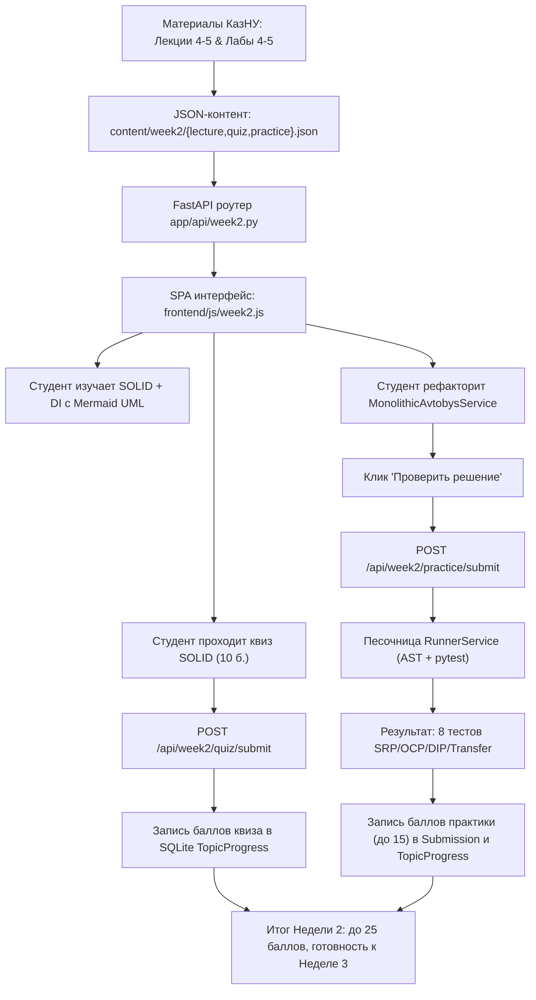

# HL — OOP_20261021-130458_W2SOLID: Наполнение платформы материалами Недели 2: принципы SOLID и Dependency Injection

> **Current filename**: `HL-OOP_20261021-130458_W2SOLID.md`
> **Date**: 2026-10-21
> **Author**: saubakirov
> **Title**: Наполнение платформы материалами Недели 2: принципы SOLID и Dependency Injection
> **Abbreviation**: W2SOLID
> **Status**: 📝 HL_APPROVED
> **Contract**: 🔒 FROZEN — approved by saubakirov 2026-10-21
> **Frozen**: §1 · §3 · §4 · §5 · §6 · §7 — locked on owner approval
> **Free**: §2 · §7.2 · §8 · §9 · §10 · §11 — research updates these directly
> **Append-only**: §12 Amendment Log — the only channel for changing a frozen section
> **Baseline**: freeze commits — recovery form in `conventions.md` §3 rule 15
> **Project North Star**: `README.md #ns1 · #ns2 · #ns3`

---

## 1. Vision 🔒 FROZEN

Платформа Web OOP переходит от одного учебного модуля к полноценному двухнедельному курсу: для Недели 2 («Принципы SOLID и Dependency Injection») развёрнуты структурированные теоретические материалы по SRP, OCP, LSP, ISP и DIP с живыми UML-диаграммами (Mermaid.js), интерактивный квиз на проверку понимания каждого принципа, и онлайн-практикум с рефакторингом «грязного» монолитного сервиса `MonolithicAvtobysService`. Студенты второго курса КазНУ разбирают конкретные нарушения SOLID в транспортной системе Avtobys, проводят декомпозицию по SRP, реализуют расширяемость через OCP, внедряют зависимости через абстракции (DIP) и добавляют бесплатную пересадку за 60 минут без модификации ядра. Прозрачные баллы (до 25 за неделю: 10 за квиз + 15 за практику) с автоматической проверкой через RunnerService и сохранением прогресса в SQLite.

**Impact:** Курс покрывает 2 из 3 недель. Студенты получают практический опыт рефакторинга реального (пусть учебного) монолита по принципам SOLID — навык, который непосредственно переносится на профессиональную разработку. Преподаватель видит расширенную систему автооценивания с 25-балльным модулем. Платформа формирует эталонный повторяемый формат для финальной Недели 3.

> *«Я увидел конкретный MonolithicAvtobysService с if-elif спагетти на 60 строк, понял, что FareCalculator и TransactionLogger — это разные ответственности, разбил его по SRP и OCP, написал DI-контейнер на 5 строк — и 8 тестов позеленели. Теперь SOLID — не абстрактная теория из учебника, а рефакторинг, который я сделал руками».*

---

## 2. Current State (As-Is) 🟢 FREE

1. **Работающий модуль Недели 1 (результат `OOP_20261014-133501_W1MAT`):**
   - Контент в `content/week1/` (`lecture.json`, `quiz.json`, `practice.json`), эталонные тесты `test_domain_w1.py`.
   - Бэкенд: `app/api/week1.py` (6 эндпоинтов), `app/services/content_service.py` (жёстко привязан к `content/week1`).
   - Фронтенд: SPA с 3 вкладками (Лекция, Квиз, Практикум), `frontend/js/app.js` (856 строк).
   - 24 автотеста зелёные, ruff clean. Всё верифицировано REVIEW.

2. **Узкие места и пробелы:**
   - Каталог `content/week2/` не существует.
   - Нет `app/api/week2.py`, нет маршрутов Недели 2 в `app/main.py`.
   - `ContentService` не параметризован по неделям — экземпляр `content_service` жёстко указывает на `content/week1`.
   - `app/api/course.py` → описание Недели 2 устарело: указывает «Наследование, Полиморфизм & SOLID», хотя curriculum определяет тему как «SOLID + DI».
   - Фронтенд (`app.js`) обрабатывает только Week 1; навигация на Неделю 2 отсутствует.

3. **Методическая основа кафедры (доступна):**
   - `G:\My Drive\AgentSharedFolder\KazNU\OOP\01_Лекции\Лекция_04_SOLID_Часть_1_SRP_и_OCP_Cohesion_Coupling.pdf` + `RF__lecture_04.pdf`
   - `G:\My Drive\AgentSharedFolder\KazNU\OOP\01_Лекции\Лекция_05_SOLID_Часть_2_LSP_ISP_DIP_Dependency_Injection.pdf` + `RF__lecture_05.pdf`
   - `G:\My Drive\AgentSharedFolder\KazNU\OOP\02_Лабораторные\Лабораторная_04_Рефакторинг_спагетти_кода_SRP_и_OCP.pdf` + `RF__lab_04.pdf`
   - `G:\My Drive\AgentSharedFolder\KazNU\OOP\02_Лабораторные\Лабораторная_05_Практикум_Midterm_DI_Container_LSP_ISP.pdf` + `RF__lab_05.pdf`
   - Учебный план: `docs/course_curriculum.md` → 25 баллов за Неделю 2.

---

## 3. Target State (To-Be) 🔒 FROZEN

Реализовать комплексный интерактивный модуль Недели 2 по паттерну, установленному Неделей 1, со следующей архитектурой:

1. **Слой данных учебного контента (`content/week2/`):**
   - `content/week2/lecture.json`:
     - Текст и структура лекции 2: «Принципы SOLID и Dependency Injection».
     - 5 ключевых тем: 1) SRP — единая причина для изменения, cohesion & coupling; 2) OCP — открыт для расширения, закрыт для модификации; 3) LSP — подклассы не ломают ожидания клиентов; 4) ISP — не заставлять клиентов зависеть от неиспользуемых интерфейсов; 5) DIP — зависимости строятся на абстракциях, внедрение зависимостей (DI).
     - Интерактивные диаграммы Mermaid.js: `classDiagram` декомпозиции монолита по SRP и `sequenceDiagram` DI-контейнера.
   - `content/week2/quiz.json`:
     - 6–8 тестовых вопросов по SOLID-принципам с вариантами ответов, разъяснениями и весами (суммарно 10 баллов).
   - `content/week2/practice.json`:
     - Описание практической лабораторной работы 2: рефакторинг `MonolithicAvtobysService` и построение DI-контейнера.
     - Стартовый «грязный» монолит (50–80 строк) с наглядными нарушениями SRP и OCP.
     - Стартовый шаблон решения с аннотациями типов и docstrings.
     - Эталонный тестовый сьют `test_solid_w2.py` на базе `pytest`, проверяющий: декомпозицию по SRP (отдельные сервисы), расширяемость без модификации (OCP), внедрение зависимостей (DIP), бесплатную пересадку 60 мин (OCP).
     - Разбалловка: 15 баллов за 100% pass. Общий балл за неделю = 25 баллов.

2. **Бэкенд сервисы и API (`app/api/week2.py`, `app/services/week2_content_service.py`):**
   - `GET /api/week2/lecture`: выдача структурированной лекции и схем Mermaid.
   - `GET /api/week2/quiz`: выдача вопросов теста (без раскрытия верных ответов).
   - `POST /api/week2/quiz/submit`: валидация ответов студента, расчет баллов (до 10), формирование фидбека и сохранение прогресса в `TopicProgress`.
   - `GET /api/week2/practice`: получение условий практики, монолитного кода и стартового шаблона.
   - `POST /api/week2/practice/submit`: отправка студенческого кода в `RunnerService`, прогон через эталонный тестовый сьют, фиксация попытки в `Submission` и сохранение набранных баллов (до 15) в `TopicProgress`.
   - `GET /api/week2/progress`: агрегированный статус прохождения недели студентом (баллы за квиз, баллы за практику, суммарный результат X/25).

3. **Интерактивный Zero-Build интерфейс (расширение SPA в `frontend/`):**
   - Навигационный переход: карточка Недели 2 на обзоре курса открывает динамический учебный дашборд Недели 2.
   - Вкладки модуля Недели 2:
     - **Вкладка «📖 Лекция SOLID & DI»**: структурированное чтение с живыми блоками кода и авторендерингом Mermaid UML-диаграмм.
     - **Вкладка «❓ Проверочный квиз»**: интерактивный опросник, мгновенная проверка ответов и начисление баллов (до 10).
     - **Вкладка «💻 Практикум»**: формулировка задачи рефакторинга, исходный монолит, требования к декомпозиции, редактор кода, кнопка «▶ Проверить решение», форматированный консольный лог pytest (до 15 баллов).
     - Общий индикатор успеваемости недели: бейдж `Прогресс: X / 25 баллов`.

4. **Обновление обзора курса:**
   - `app/api/course.py` → обновить описание Недели 2 с актуальной тематикой SOLID + DI, установить `is_ready: True` для топиков `w2-t1`, `w2-t2`, `w2-t3`.

5. **Автоматическое тестирование и гарантия качества:**
   - Тесты API `tests/test_api_week2.py` (все эндпоинты Недели 2).
   - Интеграционный тест `tests/test_content_week2.py` (валидность JSON-контента, проверка эталонного решения через `RunnerService` на 100% pass).
   - Линтинг `ruff check .` без замечаний.
   - Все существующие тесты (Week 1 и платформа) продолжают проходить.

---

### 3.1 Result Visualization

```text
Браузер студента: http://localhost:8000/ (Раздел: Неделя 2)
┌──────────────────────────────────────────────────────────────────────────────────────────┐
│ 🎓 Web OOP — КазНУ CS2203   [← К обзору курса]  [Неделя 2: Активна]  [Баллы: 25/25]    │
├──────────────────────────────────────────────────────────────────────────────────────────┤
│ 🟢 Бэкенд: Активен | SQLite: Connected | Раннер: Готов                                   │
├──────────────────────────────────────────────────────────────────────────────────────────┤
│ ┌──────────────────────────────────────────────────────────────────────────────────────┐ │
│ │ Вкладки: [ 📖 1. Лекция SOLID & DI ]  [ ❓ 2. Квиз (10 б.) ] [ 💻 3. Практикум (15 б.) ] │
│ └──────────────────────────────────────────────────────────────────────────────────────┘ │
│                                                                                          │
│ ▼ АКТИВНА ВКЛАДКА «3. Практикум: Рефакторинг MonolithicAvtobysService»                   │
│                                                                                          │
│ ┌──────────────────────────────────────┐ ┌───────────────────────────────────────────┐   │
│ │ 📋 Задание и требования             │ │ 💻 Редактор решения (Python 3.12)         │   │
│ │                                      │ │                                           │   │
│ │ Исходный монолит MonolithicService   │ │ from abc import ABC, abstractmethod       │   │
│ │ нарушает SRP и OCP:                  │ │ from decimal import Decimal               │   │
│ │ - 4 ответственности в 1 классе       │ │                                           │   │
│ │ - if-elif на каждый тип тарифа       │ │ class FareCalculator(ABC):                │   │
│ │ - жёсткая привязка к БД/логгеру      │ │     @abstractmethod                       │   │
│ │                                      │ │     def calculate(self, card) -> Decimal:  │   │
│ │ Требования:                          │ │         ...                               │   │
│ │ 1. Разделить по SRP (3 сервиса)      │ │                                           │   │
│ │ 2. Расширяемость (OCP) — новый       │ │ class StandardFare(FareCalculator):        │   │
│ │    тариф без правки ядра             │ │     def calculate(self, card):             │   │
│ │ 3. DI — абстракции в конструктор     │ │         return Decimal("150")              │   │
│ │ 4. Пересадка 60 мин (OCP)            │ │                                           │   │
│ └──────────────────────────────────────┘ └───────────────────────────────────────────┘   │
│                                                                                          │
│ ┌──────────────────────────────────────────────────────────────────────────────────────┐ │
│ │ [ ▶ Запустить автопроверку через RunnerService ]            [ Статус: ✅ 15/15 ]     │ │
│ ├──────────────────────────────────────────────────────────────────────────────────────┤ │
│ │ 📟 Вывод pytest:                                                                     │ │
│ │ tests/test_solid_w2.py::test_srp_separate_fare_calculator PASSED                     │ │
│ │ tests/test_solid_w2.py::test_srp_separate_transaction_logger PASSED                  │ │
│ │ tests/test_solid_w2.py::test_ocp_add_student_fare_no_core_change PASSED              │ │
│ │ tests/test_solid_w2.py::test_dip_inject_abstract_calculator PASSED                   │ │
│ │ tests/test_solid_w2.py::test_transfer_discount_within_60min PASSED                   │ │
│ │ ============================== 8 passed in 0.41s ===================================  │ │
│ └──────────────────────────────────────────────────────────────────────────────────────┘ │
└──────────────────────────────────────────────────────────────────────────────────────────┘
```

---

### 3.2 Value Flow



---

## 4. Phases 🔒 FROZEN

Задача является связной и выполняется как **единая фаза (Single-phase task)**:

- **Phase A (Single-phase):** Наполнение Недели 2 (Контент, API, Интерактивный UI, Автопроверка и Тесты).
  - **Приоритет:** 🔴 High
  - **Deliverables:**
    1. Каталог контента `content/week2/` (`lecture.json`, `quiz.json`, `practice.json`, тестовый сьют `test_solid_w2.py`).
    2. Бэкенд-сервис `app/services/week2_content_service.py` и API-роутер `app/api/week2.py` с регистрацией в `app/main.py`.
    3. Обновлённый фронтенд: дашборд Недели 2 с табами (Лекция, Квиз, Практикум), редактором кода и панелью автопроверки. Навигация из обзора курса.
    4. Интеграция с БД SQLite: сохранение баллов за квиз и практику в `TopicProgress` и попыток в `Submission` с `week_number=2`.
    5. Обновление `app/api/course.py` с актуальным описанием Недели 2 и `is_ready: True`.
    6. Автотесты в `tests/test_api_week2.py` и `tests/test_content_week2.py` со 100% прохождением и чистым `ruff`.

### 4.1 Coordination Selection 🔒 FROZEN

| Источник активации | Ответственный владелец | Координатор задачи | Правило координатора фазы | Охват ролей / мандат | Upward route | Диалог | Репортинг | Ограничения и резервирования | Полномочия правок | Неизменяемая эпоха |
|---|---|---|---|---|---|---|---|---|---|---|
| `owner-direct` | `saubakirov` | `antigravity:thread:local:822e3e77-a90e-4ce8-9003-e6992c156f6c` | `none` (однофазная задача) | task Coordinator: HL/TS; Executor: handoff (subagent); Reviewer: review (subagent) | `owner:saubakirov` | `tfw-gates-only` | `native-gates` | Владелец утверждает HL, TS, ключевые изменения скоупа и итоговое закрытие | `none` | baseline |

*Режим координации:* **Single-phase agent mode**: Координатор запускает Researcher, Executor и Reviewer как subagent'ов. Роли возвращают статус и артефакты вертикально Координатору через `send_message`.

---

## 5. Definition of Done (DoD) 🔒 FROZEN

- ☐ 1. Создан структурированный контент Недели 2 в `content/week2/` (полный текст лекции по 5 принципам SOLID + DI с Mermaid-диаграммами, квиз на 6–8 вопросов, лабораторная работа с монолитом и эталонными тестами `test_solid_w2.py`).
- ☐ 2. Реализован бэкенд-модуль `app/api/week2.py` со всеми эндпоинтами лекции, квиза, практики и прогресса.
- ☐ 3. Реализована валидация квиза и автопроверка решений практики через `RunnerService` с фиксацией попыток в `Submission` и прогресса в `TopicProgress`.
- ☐ 4. Создан интерактивный SPA-интерфейс Недели 2 в `frontend/` с переключением табов (Лекция, Квиз, Практикум), рендерингом Mermaid.js, интерактивной формой теста и редактором кода с запуском проверки.
- ☐ 5. Эндпоинт `/api/course/overview` корректно отражает обновлённый статус Недели 2 (тематика SOLID + DI, `is_ready: True`).
- ☐ 6. Написаны и успешно проходят тесты `tests/test_api_week2.py` и `tests/test_content_week2.py` (100% pass), проверка `ruff check .` проходит без ошибок.
- ☐ 7. Все существующие тесты платформы и Недели 1 продолжают проходить без регрессий.

---

## 6. Definition of Failure (DoF) 🔒 FROZEN

- ❌ 1. Учебный контент содержит заглушки вида `TODO`, `pass`, «текст лекции будет добавлен позже» или неполные описания принципов.
- ❌ 2. Монолитный стартовый код для рефакторинга тривиален (< 30 строк) или наоборот чрезмерно сложен (> 100 строк).
- ❌ 3. Квиз или проверка практики не сохраняют заработанные баллы студента в таблицу `TopicProgress` в SQLite.
- ❌ 4. Проверка студенческого кода виснет без таймаута или допускает небезопасное выполнение запрещённых системных команд.
- ❌ 5. В интерфейс добавлены тяжёлые Node.js/npm зависимости или сборщики, нарушающие принцип Zero-build.
- ❌ 6. Падают существующие тесты платформы (`test_api_health`, `test_db_models`, `test_runner_service`) или тесты Недели 1 (`test_api_week1`, `test_content_week1`).

**При сбое:** Немедленная остановка, локализация причины, откат деструктивных правок через Git, устранение регрессий.

---

## 7. Principles 🔒 FROZEN

1. **SOLID на практике, не в теории:** Студент должен увидеть конкретное нарушение каждого принципа в коде монолита и исправить его руками — не просто прочитать определение.
2. **Zero-Build & Local-First:** Никаких npm/webpack/vite. Фронтенд работает напрямую в браузере через нативные ES-модули, Tailwind CDN и Mermaid.js CDN.
3. **Изоляция от Недели 1:** Отдельный ContentService, отдельный API-роутер, отдельный JS-модуль — нулевой риск регрессий работающего модуля.
4. **Прозрачность оценивания:** Чёткая шкала баллов (10 за квиз, 15 за практику = 25 за неделю), понятные сообщения об ошибках и мгновенная обратная связь.

### 7.1 Quality Contract 🔒 FROZEN

- Стиль кода: соответствие PEP 8, проверка линтером `ruff check .`.
- Чистота зависимостей: не добавлять новых зависимостей в `pyproject.toml`.

### 7.2 Knowledge Citations 🟢 FREE

| # | Источник | Элемент | Как применяется в задаче |
|---|---|---|---|
| 1 | `README.md` | North Star NS1 (Интерактивный мини-курс 2-3 недели) | Расширение курса до второй недели |
| 2 | `README.md` | North Star NS2 (AI-friendly, Zero-build, Local-first) | Реализация без npm-сборщиков на чистом HTML5 + Tailwind CDN + Vanilla JS + SQLite |
| 3 | `README.md` | North Star NS3 (Non-goals) | Отказ от сложной микросервисной архитектуры |
| 4 | `.tfw/README.md` | Methodology values | Строгий ролевой лок TFW, проверяемость всех AC |
| 5 | `KNOWLEDGE.md` §1 | D1 (Стек: FastAPI, Tailwind CDN, Vanilla JS, Mermaid) | Использование утверждённого стека для дашборда Недели 2 |
| 6 | `KNOWLEDGE.md` §1 | D4 (Персистентность: SQLite models) | Использование таблиц `TopicProgress`, `Submission` с `week_number=2` |
| 7 | `KNOWLEDGE.md` §1 | D6 (RunnerService песочница) | Запуск автотестов лабораторной через `RunnerService` с таймаутом 5 сек |
| 8 | `KNOWLEDGE.md` §1 | D7 (Учебный модуль Недели 1) | Паттерн реализации: JSON-контент, маскирование квиза, SPA с табами |
| 9 | `knowledge/records/REC-20261014-01-week1-architecture.md` | Архитектура W1 | Повторение проверенного паттерна для W2 |

---

## 8. Dependencies 🟢 FREE

| Зависимость | Статус |
|---|---|
| Бэкенд FastAPI и роутинг (`app/main.py`) | ✅ Готов |
| БД SQLite и модели `TopicProgress`, `Submission` (`app/models/course.py`) | ✅ Готов |
| Изолированный сервис запуска тестов `RunnerService` (`app/services/runner.py`) | ✅ Готов |
| Модуль Недели 1 как образец (`app/api/week1.py`, `content_service.py`) | ✅ Готов, DONE |
| Материалы кафедры КазНУ (Лекции 4-5, Лабы 4-5) | ✅ Доступны |

---

## 9. Risks 🟢 FREE

| Риск | Вероятность | Влияние | Стратегия смягчения |
|---|---|---|---|
| Монолит для рефакторинга слишком сложен для 1-часовой практики | Средняя | Высокая | Ограничить 50–80 строк с 3–4 явными нарушениями SRP/OCP |
| Тесты SOLID-рефакторинга хрупкие (проверяют имена классов) | Средняя | Средняя | Проверять контракты (isinstance, ABC), а не имена |
| Конфликт naming с Week 1 JS/CSS | Низкая | Средняя | Отдельный `week2.js`, изолированные ID элементов |
| Студент отправляет код с бесконечным циклом | Высокая | Средняя | `RunnerService` прерывает через `timeout=5s` |

---

## 10. RESEARCH Case 🟢 FREE

### Blind Spots
- Оптимальная сложность «грязного» монолита: достаточно грязный, чтобы нарушения были очевидны, но компактный для 1-часовой работы.
- Проверка SOLID-рефакторинга тестами: как убедиться, что студент действительно разделил ответственности, а не просто переименовал классы.

### Hypotheses

| # | Гипотеза | Статус |
|---|---|---|
| H1 | MonolithicAvtobysService в 50–80 строк достаточен для демонстрации 3–4 нарушений SOLID | open |
| H2 | Тесты через isinstance(calculator, ABC) и проверку инъекции надёжнее, чем проверка имён классов | open |

### Risks of Not Researching
Риск минимален: архитектура и контракты взаимодействия уже проверены в задаче W1MAT. Паттерн повторяется. Основная неопределённость — методическая (формат монолита), а не техническая.

### Why Not Just...?

| Подход | Ценность | Нагрузка и сложность | Риски и компромиссы | Решение и обоснование |
|---|---|---|---|---|
| **Рекомендуемый: Изолированный модуль W2** (Лекция SOLID + Квиз + Рефакторинг-практикум в RunnerService) | Максимальная: интерактивный рефакторинг с автопроверкой, нулевой риск регрессий W1 | Средняя: копия паттерна W1 с адаптацией контента | Дублирование ~60% кода сервисов; при 3 неделях окупается | **Выбран** |
| **Обобщённый ContentService для всех недель** | Снижает дублирование | Рефакторинг существующего W1, регрессии | Окупается при ≥5 неделях, курс 3-недельный | **Отклонён** |
| **Только статическая лекция без интерактива** | Низкая: нет практики | Минимальная | RunnerService не используется, автооценивание отсутствует | **Отклонён** |

**Оставить без изменений:** платформа остаётся на 1/3 курса, учебный процесс прерывается после Недели 1.

**Критический вызов:** стартовый монолит для рефакторинга — ключевой методический артефакт. Если он тривиален, студент не научится; если чрезмерно сложен, не уложится в 1 час. Оптимум: 50–80 строк с 3–4 яркими нарушениями (смешение тарификации, логирования, валидации и БД-записи в одном классе).

---

## 11. Strategic Insights (Planning) 🟢 FREE

| # | Инсайт | Категория | Источник |
|---|---|---|---|
| S1 | Сквозной домен Avtobys обеспечивает преемственность от Недели 1 (инварианты) к Неделе 2 (SOLID) и далее к Неделе 3 (GoF + Clean Architecture) | Domain / Architecture | Владелец, силлабус КазНУ CS2203 |
| S2 | Паттерн копирования модуля (isolate each week) оправдан при 3 неделях и исключает риск регрессий на работающем учебном процессе | Tech Decision | Coordinator analysis |
| S3 | Рефакторинг как формат практики — педагогически ценнее написания с нуля: студент видит проблему до решения | Pedagogy | Лабораторная 4 КазНУ |

---

## 12. Amendment Log 🟢 APPEND-ONLY

**No amendments.**

---

*HL — OOP_20261021-130458_W2SOLID: Наполнение платформы материалами Недели 2: принципы SOLID и Dependency Injection | 2026-10-21*
