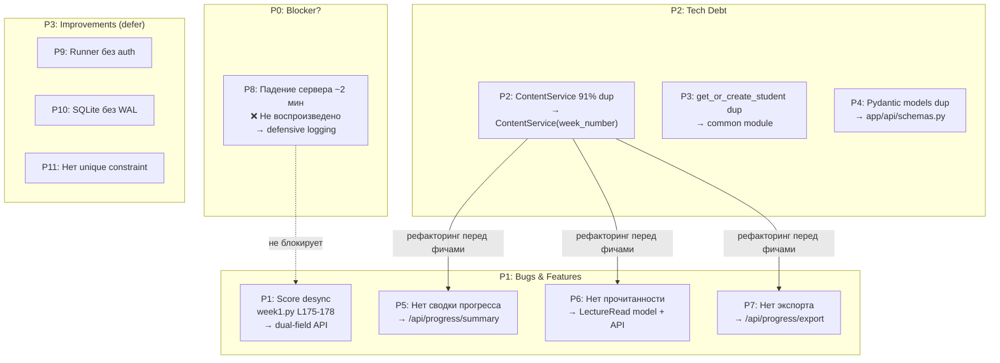

# RES — OOP_20261021-140019_RSPN3: Рефакторинг и стабилизация платформы перед Неделей 3

> **Current filename**: fixed `research/iter1/RES.md`

> **Date**: 2026-10-21
> **Author**: saubakirov
> **Status**: 🔬 RES — Complete
> **Parent HL**: [HL-OOP_20261021-140019_RSPN3](../../HL-OOP_20261021-140019_RSPN3.md)
> **Mode**: Pipeline
> **Producer unit**: Researcher subagent (Antigravity subagent of 9acfb628-dc99-4483-ac36-00c9a4e3c115)
> **Parent Coordinator**: antigravity:thread:local:9acfb628-dc99-4483-ac36-00c9a4e3c115
> **Activation / dispatch source**: Coordinator dispatch `/tfw-research OOP_20261021-140019_RSPN3`
> **Coordination authority**: HL-OOP_20261021-140019_RSPN3.md @ 05d0771dc9fb9872eb98aaeb3a6ba415e3b63060
> **Originating proposer**: none

---

## Research Context

Полный аудит кодовой базы платформы Web OOP перед запуском Недели 3. Проверка 3 гипотез из HL §10 (причина падения сервера, рассинхрон баллов, скрытые архитектурные долги), инспекция всех 7 проблем из HL §2, поиск незамеченных проблем.

## Briefing

Reference: [`research/iter1/1_briefing.md`](1_briefing.md)

## Decisions

| # | Decision | Rationale |
|---|----------|-----------|
| D1 | H1 (StaticFiles crash) не подтверждена — сервер стабилен | Эмпирическая проверка: сервер работает >2 мин, все API отвечают. Порядок маршрутов корректен (API перед mount). Starlette использует `anyio` для async I/O. `--reload` следит только за `.py` |
| D2 | H2 (score desync) подтверждена — fix через dual-field API response | `week1.py` L175-178 не обновляет `progress.score` при `passed=False`. API возвращает сохранённый best, а не текущий. Fix: добавить `current_score` и `best_score` в response |
| D3 | H3 (скрытые долги) подтверждена — 4 доп. проблемы найдены | runner без auth (P3), SQLite без WAL (P3), нет unique constraint (P3), JSON перечитывается при каждом запросе (P3) |
| D4 | Week 2 router уже подключён (исправлен в W2SOLID) | `main.py` L48: `app.include_router(week2_router)`. Эмпирически подтверждено |
| D5 | ContentService рефакторинг через параметрический `ContentService(week_number)` | 91% дублирования. `get_practice()` — единственное различие: возвращать все поля из JSON, фронтенд берёт нужные |
| D6 | Объединить только ContentService и `get_or_create_student()`, API-модули оставить раздельными | Принцип минимальных изменений (HL §7 п.3). API-модули структурно похожи (~85%), но объединение сложнее и рискованнее |
| D7 | P8 (падение сервера) адресовать через defensive logging, не через код-fix | Причина внешняя и невоспроизводимая. Executor добавляет logging middleware и инструкцию для traceback |

## Open Questions

| # | Question | Status | Answer |
|---|----------|--------|--------|
| Q1 | Что именно вызывает падение сервера через ~2 мин? | ⚪ open | Не воспроизведено. Нужен traceback от владельца при повторении |

## Hypotheses (from HL §10)

| # | Hypothesis | HL Status | RES Status | Evidence |
|---|-----------|-----------|------------|----------|
| H1 | Сервер падает из-за конфликта StaticFiles mount на `/` с API-маршрутами | open | ❌ rejected | Эмпирический запуск: стабилен >2 мин. Маршруты не конфликтуют (API первые, mount последний). Starlette async I/O через anyio. Web search: watchfiles PythonFilter `.py` only |
| H2 | Рассинхрон баллов вызван только логикой «keep best» без отображения текущего результата | open | ✅ confirmed | `week1.py` L175-178: при `passed=False` score не обновляется. API L187 возвращает `progress.score` (best). UI `app.js` L805 показывает `10/10` рядом с `❌ failed` |
| H3 | В кодовой базе есть дополнительные незамеченные архитектурные долги помимо известных 7 проблем | open | ✅ confirmed | 4 доп. находки: runner без auth, SQLite без WAL, нет unique constraint на TopicProgress, JSON re-read при каждом запросе |

## HL Update Recommendations

### Refinements — free sections, coordinator applies

| # | § | What to update | Source |
|---|---|----------------|--------|
| R1 | §2 | П.3 (Week 2 роутер не подключён) → обновить: «Исправлено в W2SOLID. `main.py` L48 содержит `app.include_router(week2_router)`. Все эндпоинты Week 2 работают.» | G3, D4 |
| R2 | §2 | П.1 (Сервер падает через ~2 мин) → уточнить: «Не воспроизведено в контролируемых условиях (запуск без/с --reload, эмпирическая проверка >2 мин). Предположительно внешняя причина. Executor добавит logging для диагностики.» | G1, D1, D7 |
| R3 | §2 | Добавить пп.8-11: runner без auth (P3), SQLite без WAL (P3), нет unique constraint (P3), JSON re-read (P3) | G6, D3 |
| R4 | §9 | Обновить Risk «Причина падения не в StaticFiles»: Probability→Confirmed, Mitigation→«defensive logging, инструкция для traceback» | G1, D7 |
| R5 | §10 | Обновить статусы гипотез: H1→rejected, H2→confirmed, H3→confirmed | Все стадии |
| R6 | §8 | Добавить зависимость: `aiofiles` не нужен (Starlette 0.45+ использует anyio) | G1 |

### Amendment Proposals — frozen sections, resolved-ruler verdict required

**No amendment proposals.** Все находки адресуются через существующие DoD-критерии (§5 пп.1-9) и Phase B. P9-P11 (P3-improve) не входят в DoD и могут быть отложены.

## Fact Candidates

| # | Category | Candidate | Source | Confidence |
|---|----------|-----------|--------|------------|
| FC1 | environment | Владелец запускает сервер без сохранения traceback; падение сервера наблюдается визуально, без логов | Владелец, Briefing Q1 ответ | ★★★ |
| FC2 | stakeholder | Рассинхрон баллов замечен владельцем конкретно для Week 1 practice: «нажал проверить, failed все тесты, но баллы 10/10» | Владелец, Briefing Q2 ответ | ★★★ |

## Strategic Insights (Research)

No strategic insights. Все находки — результат кодовой инспекции, не человеческого доменного знания.

## Findings Map

## Iteration Status

- **Iteration:** 1 of 1 (min) / 2 (max)
- **Hypotheses tested:** H1 (rejected), H2 (confirmed), H3 (confirmed)
- **Hypotheses deferred:** None
- **Gaps discovered:** Q1 (точная причина падения сервера — нужен traceback от владельца)
- **Superseded decisions:** None

### Open Threads (for next iteration)

No open threads. Все гипотезы обработаны, все проблемы категоризированы. Единственный open question (Q1) требует данных от владельца, а не дополнительного исследования.

### Recommendation
- [x] **SUFFICIENT** — proceed to `/tfw-plan` to classify these recommendations and write TS
- [ ] **MORE NEEDED** — {specify what and why}
- [ ] **BLOCKED** — {specify blocker}

> ⚠️ Coordinator decides whether to continue or proceed. Researcher recommends but does NOT decide.

## Conclusion

Исследование проверило все 3 гипотезы и проинспектировало полную кодовую базу (app/, frontend/js/, tests/). H1 (StaticFiles crash) **отвергнута** через эмпирическую проверку и анализ маршрутизации — сервер стабилен в контролируемых условиях. H2 (score desync) **подтверждена** — `week1.py` L175-178 не обновляет score при failure, API возвращает сохранённый best, UI показывает его рядом с `❌ failed`. H3 (скрытые долги) **подтверждена** — найдены 4 дополнительные проблемы P3-уровня. Исследование выявило ключевой факт: Week 2 router уже подключён (исправлен в W2SOLID), что обновляет HL §2. Главная ценность исследования — приоритизированный список из 11 проблем с конкретными строками кода и стратегиями исправления, включая rejection H1, которая сэкономит Executor'у время на ложную диагностику. Самокритика: причина падения сервера не установлена (Q1 open), но это ограничение данных, а не метода.

### Material handover at this return

**Producer/unit:** Researcher subagent (Antigravity subagent of 9acfb628-dc99-4483-ac36-00c9a4e3c115).
**Source/epoch:** Инспекция исходного кода (app/, frontend/js/, tests/, content/), эмпирический запуск сервера, web search (uvicorn watchfiles, Starlette StaticFiles), 2026-10-21.
**Inspected scope:** `app/main.py`, `app/api/week1.py`, `app/api/week2.py`, `app/api/health.py`, `app/api/course.py`, `app/api/runner.py`, `app/services/content_service.py`, `app/services/week2_content_service.py`, `app/services/runner.py`, `app/db/session.py`, `app/models/course.py`, `app/core/config.py`, `frontend/js/app.js`, `frontend/js/api.js`, `frontend/js/week2.js`, `pyproject.toml`. Тесты: 36/36 passed. Ruff: clean.
**Material:** 11 проблем (P1-bug: 1, P1-feature: 3, P2-debt: 3, P3-improve: 3, P0-?: 1). 3 гипотезы (1 rejected, 2 confirmed). 6 HL refinements. 0 amendments.
**Uncertainty:** Q1 — точная причина падения сервера неизвестна (нет traceback от владельца). H1 rejection основан на невоспроизводимости, а не на доказательстве отсутствия бага.
**Recipient:** Coordinator для review recommendations и перехода к TS/Phase B.
**Continuation:** `/tfw-plan` — Coordinator классифицирует рекомендации, пишет TS для Phase B.

---

*RES — OOP_20261021-140019_RSPN3: Рефакторинг и стабилизация платформы перед Неделей 3 | 2026-10-21*
