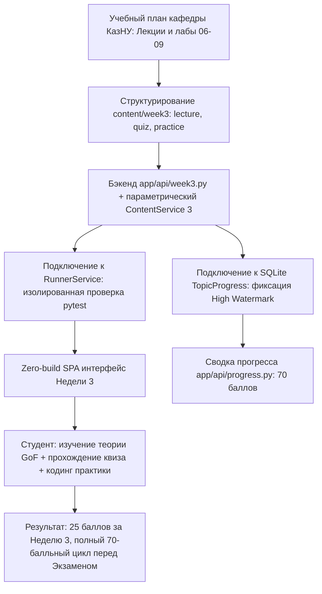

# HL — OOP_20261028-121120_W3PAT: Наполнение платформы материалами Недели 3: Паттерны GoF и основы чистой архитектуры

> **Current filename**: `HL-OOP_20261028-121120_W3PAT.md`
> **Date**: 2026-10-28
> **Author**: saubakirov
> **Title**: Наполнение платформы материалами Недели 3: Паттерны GoF и основы чистой архитектуры
> **Abbreviation**: W3PAT
> **Status**: 📝 HL_APPROVED
> **Contract**: 🔒 FROZEN — approved by saubakirov 2026-10-28
> **Frozen**: §1 · §3 · §4 · §5 · §6 · §7 — locked on owner approval
> **Free**: §2 · §7.2 · §8 · §9 · §10 · §11 — research updates these directly
> **Append-only**: §12 Amendment Log — the only channel for changing a frozen section
> **Baseline**: freeze commits — recovery form in `conventions.md` §3 rule 15
> **Project North Star**: `README.md #ns1 · #ns2 · #ns3`

---

## 1. Vision 🔒 FROZEN

Платформа Web OOP завершает трехнедельный теоретический и лабораторный цикл курса ООП для второкурсников КазНУ: развернут полноценный модуль Недели 3 («Паттерны проектирования GoF и основы чистой архитектуры»). Модуль включает интерактивную лекцию с живыми UML-диаграммами Mermaid.js (порождающие: Factory Method, Builder; структурные: Adapter, Decorator, Facade; поведенческие: Strategy, Observer, Chain of Responsibility; чистая архитектура: Entities, Use Cases, Infrastructure Adapters), концептуальный квиз на 10 баллов с динамическим разбором ошибок, и лабораторный практикум на 15 баллов с автоматической проверкой решений в RunnerService. Студенты реализуют сквозной конвейер валидации и процессинга платежей Avtobys (согласование банковского протокола Kaspi через `BankAdapter`, кэширование и логирование через `TransactionDecorator`, многоэтапная валидация через `Chain of Responsibility` и мониторинг через `Observer`), доводя накопленный прогресс курса до 70 баллов перед финальным экзаменом.

**Impact:** Завершен весь 3-недельный аудиторный и лабораторный цикл курса (Недели 1, 2, 3). Студенты получают практический навык применения классических паттернов проектирования GoF не как изолированных шаблонов, а как согласованной системы для построения чистой архитектуры реального домена. Преподаватель видит прозрачную сводку успеваемости студентов с накоплением до 70 баллов (20 + 25 + 25). Платформа готова к развертыванию финального экзаменационного квеста.

> *«Раньше паттерны GoF казались мне списком 23 непонятных определений для зубрежки к экзамену. В этой лабораторной я своими руками написал BankAdapter для Kaspi и связал его с валидатором через цепочку проверок и логирующий декоратор — и в песочнице все 6 тестов стали зелеными. Теперь я четко вижу, где нужен Adapter, а где Chain of Responsibility, и почему архитектура должна защищать домен от внешних библиотек».*

---

## 2. Current State (As-Is) 🟢 FREE

1. **Платформа и архитектура после стабилизации (`OOP_20261021-140019_RSPN3`):**
   - Бэкенд: FastAPI на Python 3.12+, единый параметрический сервис контента `ContentService(week_number)` в `app/services/content_service.py` с кэшированием `@lru_cache`, shared-модули `app/api/deps.py` и `app/api/schemas.py`.
   - Песочница: `RunnerService` с AST-валидацией безопасности (`SecurityVisitor`) и изолированным запуском pytest subprocess (таймаут 5 сек).
   - База данных: SQLite `data/web_oop.db` с моделями `Student`, `TopicProgress` (high watermark), `Submission`, `LectureRead`.
   - Подсистема прогресса: `app/api/progress.py` (`/summary` и `/export`).
   - Фронтенд: Zero-build SPA на чистом HTML5 + Tailwind CSS (CDN) + Vanilla JS (ES-модули) + Mermaid.js.

2. **Готовые учебные модули:**
   - Неделя 1: `content/week1/` (`lecture.json`, `quiz.json`, `practice.json`), `app/api/week1.py` (20 баллов).
   - Неделя 2: `content/week2/` (`lecture.json`, `quiz.json`, `practice.json`), `app/api/week2.py`, `frontend/js/week2.js` (25 баллов).

3. **Имеющиеся разрывы перед Неделей 3:**
   - Каталог `content/week3/` не существует.
   - Нет модуля `app/api/week3.py`, роутер Недели 3 не подключен в `app/main.py`.
   - Конфигурация `WEEK_CONFIG` в `app/api/progress.py` содержит только Недели 1 и 2; максимальный балл платформы равен 45, а не 70.
   - Эндпоинт `/api/course/overview` (`app/api/course.py`) помечает Неделю 3 как `in_development` со статусом тем `is_ready: False`.
   - В веб-интерфейсе (`frontend/index.html`, `app.js`) отсутствует вкладка и логика отображения Недели 3.

4. **Методическая основа кафедры (доступна):**
   - Учебный план: `docs/course_curriculum.md` (Неделя 3: 25 баллов).
   - Лекции кафедры: `G:\My Drive\AgentSharedFolder\KazNU\OOP\01_Лекции\`:
     - Лекция 06: Порождающие паттерны GoF (Factory Method, Builder).
     - Лекция 07: Структурные паттерны GoF (Adapter, Decorator, Facade).
     - Лекция 08: Поведенческие паттерны GoF (Strategy, Observer, Chain of Responsibility).
     - Лекция 09: Чистая архитектура (Clean Architecture, рефакторинг).
   - Лабораторные кафедры: `G:\My Drive\AgentSharedFolder\KazNU\OOP\02_Лабораторные\` (Лабораторные 06, 07, 08, 09).

---

## 3. Target State (To-Be) 🔒 FROZEN

Реализовать комплексный интерактивный модуль Недели 3 на платформе Web OOP:

1. **Слой учебного контента (`content/week3/`):**
   - `content/week3/lecture.json`:
     - Текст лекции «Паттерны проектирования GoF и основы чистой архитектуры».
     - 4 раздела:
       1) Порождающие паттерны (Factory Method, Builder) и опасность Singleton.
       2) Структурные паттерны (Adapter для банков Kaspi/Halyk, Decorator для аудита и кэша, Facade терминала).
       3) Поведенческие паттерны (Strategy тарифов, Observer событий валидации, Chain of Responsibility для проверок).
       4) Clean Architecture (Entities, Use Cases, Adapters).
     - Интерактивные диаграммы Mermaid.js: `classDiagram` адаптера и цепочки обязанностей, `sequenceDiagram` прохождения транзакции через декоратор и внешнюю систему.
   - `content/week3/quiz.json`:
     - 6–8 тестовых вопросов по концепциям GoF и Clean Architecture с весами и разъяснениями (суммарно 10 баллов). Маскирование правильных ответов на стороне бэкенда.
   - `content/week3/practice.json`:
     - Описание лабораторной работы: построение пайплайна валидации и интеграции платежей Avtobys.
     - Стартовый каркас кода с типами и docstrings (`BankProtocol`, `BankAdapter`, `TransactionDecorator`, `ValidationHandler`, `LimitCheckHandler`, `StopListHandler`).
     - Эталонный тестовый сьют `test_patterns_w3.py` на базе `pytest`, проверяющий корректность работы адаптера, декоратора и цепочки обязанностей (суммарно 15 баллов).

2. **Бэкенд сервисы и REST API (`app/api/week3.py`):**
   - `GET /api/week3/lecture` — текст лекции и UML-схемы.
   - `POST /api/week3/lecture/mark-read` — отметка о прочтении.
   - `GET /api/week3/lecture/read-status` — статус прочтения лекции.
   - `GET /api/week3/quiz` — вопросы теста (без ответов).
   - `POST /api/week3/quiz/submit` — проверка ответов, расчет баллов (до 10), сохранение в `TopicProgress`.
   - `GET /api/week3/practice` — описание задания, стартовый шаблон и инварианты.
   - `POST /api/week3/practice/submit` — запуск решения в `RunnerService`, запись попытки в `Submission` и обновление баллов (до 15) в `TopicProgress` (high watermark).
   - `GET /api/week3/progress` — сводка баллов студента за 3-ю неделю (X/25).
   - Подключение роутера в `app/main.py`.

3. **Интеграция в общую систему прогресса и курса:**
   - Обновление `WEEK_CONFIG` в `app/api/progress.py`: добавление Недели 3 `(3, "w3-quiz", "w3-practice", 10, 15)`. Суммарный максимум платформы становится 70 баллов (20 + 25 + 25).
   - Обновление `app/api/course.py`: перевод Недели 3 в статус `ready_for_content` и пометка всех топиков `is_ready: True`.

4. **Интерфейс Zero-Build SPA (`frontend/`):**
   - Навигация по курсу открывает дашборд Недели 3.
   - Вкладки Недели 3: «Лекция» (с Mermaid-схемами и кнопкой «Отметить как прочитанное»), «Квиз» (интерактивный тест), «Практикум» (редактор кода с запуском в песочнице и выводом логов pytest).
   - Отображение актуальных баллов Недели 3 в шапке и в модальном окне «Мой прогресс» / экспорт.

5. **Тестирование и контроль качества:**
   - Модульные тесты API `tests/test_api_week3.py` (все эндпоинты, валидация, подсчет баллов, edge cases).
   - Валидация контента `tests/test_content_week3.py` (структура JSON, наличие диаграмм, сумма баллов квиза = 10, сьют практики = 15).
   - 100% прохождение всех тестов платформы (`pytest`), чистота линтера (`ruff check .`).

### 3.1 Result Visualization

#### Вид 1. Обзор курса (`/` -> Дашборд курса)
```
+-----------------------------------------------------------------------------------+
|  Web OOP :: Мини-LMS КазНУ CS2203                         [Студент: saubakirov]   |
|  Общий прогресс: 70 / 70 баллов (100% лекций и практики)   [Мой прогресс] [Экспорт]|
+-----------------------------------------------------------------------------------+
|                                                                                   |
|  +------------------------+  +------------------------+  +------------------------+
|  |       НЕДЕЛЯ 1         |  |       НЕДЕЛЯ 2         |  |       НЕДЕЛЯ 3         |
|  | Основы ООП & Инкапсул. |  | Принципы SOLID & DI    |  | Паттерны GoF & Clean   |
|  | 🟢 Доступно            |  | 🟢 Доступно            |  | 🟢 Доступно            |
|  | Лекция: Прочитано  ✓   |  | Лекция: Прочитано  ✓   |  | Лекция: Прочитано  ✓   |
|  | Квиз:      10 / 10 б.   |  | Квиз:      10 / 10 б.   |  | Квиз:      10 / 10 б.   |
|  | Практика:  10 / 10 б.   |  | Практика:  15 / 15 б.   |  | Практика:  15 / 15 б.   |
|  | Итого:     20 / 20 б.   |  | Итого:     25 / 25 б.   |  | Итого:     25 / 25 б.   |
|  | [Перейти к модулю →]   |  | [Перейти к модулю →]   |  | [Перейти к модулю →]   |
|  +------------------------+  +------------------------+  +------------------------+
+-----------------------------------------------------------------------------------+
```

#### Вид 2. Экран Недели 3 (`#week3`)
```
+-----------------------------------------------------------------------------------+
| ← Назад к курсу    НЕДЕЛЯ 3: Паттерны GoF и Чистая архитектура     Баллы: 25 / 25 |
| [ 📖 Лекция ]    [ ❓ Квиз (10 б.) ]    [ 💻 Практикум: Пайплайн валидации (15 б.) ]|
+-----------------------------------------------------------------------------------+
|  [Практикум: Архитектурный конвейер валидации и интеграции платежей Avtobys]       |
|                                                                                   |
|  Задание: Реализовать BankAdapter для Kaspi, TransactionDecorator для аудита      |
|  и цепочку ValidationHandler (StopListHandler -> BalanceLimitHandler).            |
|                                                                                   |
|  +--- Редактор кода (Python) --------------------------------------------------+  |
|  | class KaspiBankAdapter(PaymentProcessor):                                    |  |
|  |     def __init__(self, kaspi_api: KaspiApi): ...                            |  |
|  | class StopListHandler(ValidationHandler):                                   |  |
|  |     def handle(self, tx: Transaction) -> bool: ...                          |  |
|  +-----------------------------------------------------------------------------+  |
|  [ ▶ Запустить в песочнице (RunnerService) ]                                      |
|                                                                                   |
|  Результат: ✅ 6/6 тестов пройдено. Баллы: 15 / 15 (Сохранено в TopicProgress)     |
+-----------------------------------------------------------------------------------+
```

### 3.2 Value Flow



---

## 4. Phases 🔒 FROZEN

Задача выполняется как **однофазная** (Phase A, 🔴 Высокий приоритет) силами единого цикла TS ➔ RF ➔ REVIEW, поскольку компоненты (контент, API, фронтенд, тесты) тесно связаны между собой.

### Phase A: Реализация и интеграция модуля Недели 3 🔴
- **Deliverables:**
  1. Каталог `content/week3/` с файлами `lecture.json`, `quiz.json`, `practice.json`.
  2. Модуль `app/api/week3.py` со всеми эндпоинтами лекции, квиза, практики, прогресса и отметки чтения.
  3. Регистрация роутера Недели 3 в `app/main.py`.
  4. Обновление `WEEK_CONFIG` в `app/api/progress.py` (добавление Недели 3).
  5. Обновление статусов Недели 3 в `app/api/course.py`.
  6. Фронтенд-компоненты Недели 3 в `frontend/index.html` и `frontend/js/week3.js` (или `app.js`).
  7. Тестовые сьюты `tests/test_api_week3.py`, `tests/test_content_week3.py`, эталонный тест практики.
  8. Прохождение всех тестов проекта и линтера `ruff check .`.

### 4.1 Coordination Selection 🔒 FROZEN

| Поле | Значение |
|---|---|
| **Activation source** | owner-direct |
| **Accountable owner** | saubakirov |
| **Task Coordinator unit** | `antigravity:thread:local:702f85ed-f789-4634-9f51-44a6027572af` |
| **Phase Coordinator rule** | none (однофазная задача) |
| **Mandate scope / role reach** | `workspace/2026/OOP_20261028-121120_W3PAT` (Coordinator, Researcher, Executor, Reviewer) |
| **Upward route** | `owner:saubakirov` |
| **Dialogue** | `tfw-gates-only` |
| **Reporting** | `native-gates` |
| **Reservations / controls** | утверждение HL и TS владельцем, финальная приемка |
| **Amendment authority** | `none` |
| **Immutable epoch** | baseline |

---

## 5. Definition of Done (DoD) 🔒 FROZEN

- ✅ 1. Создан каталог `content/week3/` с валидными файлами `lecture.json`, `quiz.json`, `practice.json`.
- ✅ 2. `lecture.json` содержит не менее 4 структурированных тем по паттернам GoF и Clean Architecture, примеры кода на Python и минимум 2 диаграммы Mermaid (`classDiagram` и `sequenceDiagram`).
- ✅ 3. `quiz.json` содержит банк вопросов с весами ответов, суммарно дающими 10 баллов; бэкенд маскирует правильные ответы при выдаче.
- ✅ 4. `practice.json` содержит описание задачи, бизнес-инварианты, стартовый скелет кода и эталонный тестовый сьют `test_patterns_w3.py` на базе `pytest` (15 баллов).
- ✅ 5. Реализован модуль `app/api/week3.py`, зарегистрирован в `app/main.py`; все эндпоинты (lecture, quiz, practice, progress, mark-read) функционируют и сохраняют прогресс в SQLite.
- ✅ 6. `app/api/progress.py` включает Неделю 3 в расчет агрегированной сводки и экспорта (`WEEK_CONFIG`), повышая доступный максимум курса до 70 баллов.
- ✅ 7. `app/api/course.py` возвращает актуальный статус Недели 3 (`is_ready: True`, `status: ready_for_content`).
- ✅ 8. В веб-интерфейсе (`frontend/`) доступна вкладка Недели 3, позволяющая читать лекцию, проходить квиз и запускать решение практики в песочнице с отображением результатов.
- ✅ 9. Написаны и проходят тесты `tests/test_api_week3.py` и `tests/test_content_week3.py` (100% pass).
- ✅ 10. `ruff check .` и `pytest` выполняются без ошибок; отсутствуют регрессии в существующих тестах платформы, Недели 1 и Недели 2.

---

## 6. Definition of Failure (DoF) 🔒 FROZEN

- ❌ 1. Учебный контент Недели 3 содержит заглушки вида `TODO`, `pass`, «текст будет добавлен позже».
- ❌ 2. Практикум тривиален (< 30 строк) или требует сторонних внешних библиотек, отсутствующих в окружении проекта.
- ❌ 3. Попытки прохождения квиза или практики не сохраняют заработанные баллы в БД SQLite (`TopicProgress`, `Submission`).
- ❌ 4. Нарушен принцип Zero-build (добавлены npm, node_modules или сборщики).
- ❌ 5. Возникли регрессии в тестах платформы или Недель 1 и 2 (`test_api_week1.py`, `test_api_week2.py`, `test_progress.py`).
- ❌ 6. Зависание песочницы или пробитие AST-песочницы небезопасным кодом.

**При сбое:** Немедленная остановка, откат деструктивных правок через Git, устранение регрессий.

---

## 7. Principles 🔒 FROZEN

1. **Паттерны как решение болей, а не самоцель:** Студент видит, какую проблему архитектуры решает каждый паттерн в системе Avtobys (интеграция банков -> Adapter, аудит транзакций -> Decorator, шаги проверки -> Chain of Responsibility).
2. **Zero-Build & Local-First:** Интерфейс работает в браузере без npm/webpack/vite, используя нативные ES-модули и CDN.
3. **Чистота слоев и DIP:** Бизнес-логика валидации не зависит от конкретного банка Kaspi или Halyk, а опирается на абстрактный протокол.
4. **Прозрачность оценивания и High Watermark:** 10 баллов за квиз + 15 за практику = 25 баллов за неделю. Сохранение максимального балла студента.

### 7.1 Quality Contract 🔒 FROZEN

- Форматирование и статический анализ: строгая проверка `ruff check .`.
- Тестирование: покрытие автотестами всех новых эндпоинтов и структуры контента.
- Никаких новых внешних зависимостей в `pyproject.toml`.

### 7.2 Knowledge Citations 🟢 FREE

| # | Источник | Элемент | Как применяется в задаче |
|---|---|---|---|
| 1 | `README.md` | North Star NS1 (Мини-курс 2–3 недели) | Завершение 3-недельного цикла курса |
| 2 | `README.md` | North Star NS2 (AI-friendly, Zero-build, Local-first) | Реализация без npm-сборщиков на чистом HTML5 + Tailwind CDN + Vanilla JS + SQLite |
| 3 | `README.md` | North Star NS3 (Non-goals) | Отказ от сложной микросервисной архитектуры |
| 4 | `.tfw/README.md` | Methodology values | Строгий ролевой лок TFW, проверяемость всех AC |
| 5 | `KNOWLEDGE.md` §1 | D1 (Стек: FastAPI, Tailwind CDN, Vanilla JS, Mermaid) | Использование утверждённого стека для дашборда Недели 3 |
| 6 | `KNOWLEDGE.md` §1 | D4 (Персистентность: SQLite models) | Использование таблиц `TopicProgress`, `Submission`, `LectureRead` с `week_number=3` |
| 7 | `KNOWLEDGE.md` §1 | D6 (RunnerService песочница) | Запуск автотестов лабораторной через `RunnerService` с таймаутом 5 сек |
| 8 | `KNOWLEDGE.md` §1 | D7, D8 (Модули Недель 1 и 2) | Использование отработанного паттерна хранения JSON и эндпоинтов |
| 9 | `KNOWLEDGE.md` §1 | D9 (Стабилизация платформы) | Использование параметрического `ContentService(week_number=3)` и shared deps/schemas |
| 10 | `conventions.md` | HL Contract, Design Rules | Следование контракту и правилам оформления TFW |

---

## 8. Dependencies 🟢 FREE

| Зависимость | Статус |
|---|---|
| FastAPI бэкенд и роутинг (`app/main.py`) | ✅ Готов |
| БД SQLite и модели `TopicProgress`, `Submission`, `LectureRead` | ✅ Готов |
| Параметрический сервис контента `ContentService(week_number)` | ✅ Готов |
| Сервис изолированного запуска `RunnerService` (`app/services/runner.py`) | ✅ Готов |
| Модули Недели 1 и Недели 2 как эталоны реализации | ✅ Готов |
| Методические материалы кафедры КазНУ (лекции и лабы 06–09) | ✅ Доступны |

---

## 9. Risks 🟢 FREE

| Риск | Вероятность | Влияние | Стратегия смягчения |
|---|---|---|---|
| Практикум объединяет несколько паттернов и может оказаться перегруженным для 1 часа | Средняя | Высокая | Дать четкий стартовый каркас классов с готовыми сигнатурами и docstrings; студент реализует конкретные методы |
| Хрупкость тестов при проверке паттернов (проверка имен классов вместо контрактов) | Средняя | Средняя | Тестировать полиморфное поведение через `isinstance` и запуск сценариев через цепочку, а не жесткие внутренние атрибуты |
| Конфликты стилей или скриптов Недели 3 с предыдущими неделями | Низкая | Средняя | Изолированный модуль `frontend/js/week3.js` с префиксом `w3-` в селекторах |
| Студент отправляет зависающий код | Высокая | Средняя | Защита `RunnerService` с жестким таймаутом 5 секунд |

---

## 10. RESEARCH Case 🟢 FREE

### Blind Spots
- Оптимальный баланс объема лабораторной работы: как объединить BankAdapter и Chain of Responsibility в одном задании на 1 час, не перегружая студента кодом.
- Формулировка вопросов квиза: вопросы должны проверять понимание целесообразности паттернов и антипаттернов (например, почему Singleton вредит тестированию), а не просто запоминание названий.

### Hypotheses

| # | Гипотеза | Статус |
|---|---|---|
| H1 | Готовый скелет с абстрактными классами `PaymentProcessor` и `ValidationHandler` позволит студенту уложиться в 1 час, реализовав только `KaspiBankAdapter`, `TransactionDecorator` и 2 обработчика цепочки | open |
| H2 | Параметрический `ContentService(week_number=3)` не потребует никаких правок бэкенд-сервиса и корректно загрузит `content/week3/*.json` | open |

### Risks of Not Researching
Риск минимален: архитектурный фундамент, песочница и паттерн загрузки контента полностью стабилизированы в задаче `OOP_20261021-140019_RSPN3`. Методическая база ясна.

### Why Not Just...?

| Подход | Ценность | Нагрузка и сложность | Риски и компромиссы | Решение и обоснование |
|---|---|---|---|---|
| **Рекомендуемый: Изолированный модуль W3 (25 б.) с последующим Экзаменом отдельным таском (30 б.)** | Высокая: чистая фокусировка на паттернах GoF, контролируемый объем, 70 баллов в прогрессе | Средняя: стандартный цикл разработки учебного модуля | Экзамен потребует отдельного таска | **Выбран** — защищает контекст и обеспечивает высокое качество |
| **Объединенный таск: Неделя 3 + Финальный экзамен (55 б.)** | Единовременное закрытие всего силлабуса | Очень высокая: риск перегрузки контекста и срыва сроков | Слишком большой скоуп для одного цикла | **Отклонён** |
| **Теоретический модуль без практики в RunnerService** | Низкая: нарушает North Star NS1 | Минимальная | Студенты не получают практических навыков | **Отклонён** |

**Оставить без изменений:** Платформа останавливается на Неделе 2 (45 баллов из 100), курс ООП остается незавершенным.

**Критический вызов:** Главный риск паттернов GoF в обучении — превращение их в академическую схоластику. Чтобы этого избежать, практическое задание строится вокруг реальной проблемы Avtobys: разнородные банковские протоколы (Kaspi vs Halyk) и многоступенчатая валидация транзакции перед списанием.

---

## 11. Strategic Insights (Planning) 🟢 FREE

| # | Инсайт | Категория | Источник |
|---|---|---|---|
| S1 | Преемственность домена Avtobys: Неделя 1 (инварианты билетов) -> Неделя 2 (SOLID-декомпозиция сервиса оплаты) -> Неделя 3 (паттерны интеграции и цепочки валидации) формирует целостное архитектурное мышление | Domain / Pedagogy | Силлабус КазНУ CS2203 |
| S2 | Разделение Недели 3 и Финального экзамена на две последовательные задачи гарантирует, что экзаменационный квест-рефакторинг будет тщательно спроектирован на базе уже работающего 3-недельного контента | Architecture / Process | Координатор |
| S3 | Параметрический `ContentService` подтверждает свою архитектурную ценность: добавление новой недели сводится к созданию каталога `content/week3/` и тонкого API-роутера | Code Quality | Задача RSPN3 |

---

## 12. Amendment Log 🟢 APPEND-ONLY

**No amendments.**

---

*HL — OOP_20261028-121120_W3PAT: Наполнение платформы материалами Недели 3: Паттерны GoF и основы чистой архитектуры | 2026-10-28*
