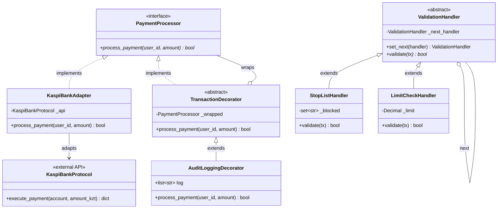

# RF — OOP_20261028-121120_W3PAT: Наполнение платформы материалами Недели 3: Паттерны GoF и основы чистой архитектуры

> **Current filename**: `RF__OOP_20261028-121120_W3PAT.md`
> **Date**: 2026-10-28
> **Author**: Executor
> **Status**: 🟢 RF — Complete
> **Parent HL**: [HL-OOP_20261028-121120_W3PAT.md](HL-OOP_20261028-121120_W3PAT.md)
> **TS**: [TS__OOP_20261028-121120_W3PAT.md](TS__OOP_20261028-121120_W3PAT.md)
> **Producer unit**: antigravity:thread:local:38b7baa3-c494-4734-9d8b-db2e5b9a248b
> **Parent Coordinator**: antigravity:thread:local:702f85ed-f789-4634-9f51-44a6027572af
> **Activation / dispatch source**: owner-direct
> **Coordination authority**: "HL-OOP_20261028-121120_W3PAT.md @ ff01b01a450f230cec47d47f79fea8d8d0d6ed85"
> **Originating proposer**: none
> **Current selection**: reporting: native-gates, selection_ref: baseline
> **Launch observation**: requested model: inherit, effective settings: standard subagent loop, delivery: complete module implementation, outcome: 100% pass, material rework: none

---

## 1. What Was Done

### Actual Value-Bearing Accounting

| Fact | Actual result |
|---|---|
| TS approval ref | `66b0964444ed89e9ddd5d8ed3cb25c9591c483cf` |
| Baseline / Candidate | `ff01b01a450f230cec47d47f79fea8d8d0d6ed85` / `ea558a7ff24b5186df12212e9293ca593a9648ce` |
| VALUE membership | 11 файлов: `content/week3/lecture.json`, `content/week3/quiz.json`, `content/week3/practice.json`, `app/api/week3.py`, `app/main.py`, `app/api/progress.py`, `app/api/course.py`, `frontend/index.html`, `frontend/js/api.js`, `frontend/js/week3.js`, `frontend/js/app.js` |
| Arithmetic | 1311 adds + 11 deletes = 1322 touched text LOC; 11 logical files; binary/non-text N/A: 0 |
| Membership deviations | none (все 11 файлов точно соответствуют спецификации TS §4) |
| Trigger disposition | Ниже триггеров декомпозиции (11 файлов < 50; 1322 LOC < 5000 LOC) |
| Authority and timing | Immutable denominator: 11 файлов / 1400 LOC, Multiplier ceiling: 22 файла / 2800 LOC, pre-work TS approval `66b0964` |
| Reproduction | `git diff --stat ff01b01a ea558a7 -- <VALUE paths>` |

### New Files

| File | Description |
|---|---|
| `content/week3/lecture.json` | Структурированная лекция: 4 темы (GoF: Creational, Structural, Behavioral + Clean Architecture) с примерами кода и 2 интерактивными UML-диаграммами Mermaid |
| `content/week3/quiz.json` | Банк тестовых вопросов (8 вопросов) с весами на 10 баллов и подробными пояснениями |
| `content/week3/practice.json` | Лабораторный практикум: условия, инварианты, стартовый скелет, эталонные автотесты `test_patterns_w3.py` (15 баллов) и эталонное решение |
| `app/api/week3.py` | FastAPI роутер Недели 3: 8 эндпоинтов (lecture, quiz, practice, progress, lecture read) |
| `frontend/js/week3.js` | Интерактивный клиентский модуль Недели 3: табы, рендеринг Mermaid, прохождение квиза, редактор кода практики и терминал песочницы |
| `tests/test_api_week3.py` | Комплексные интеграционные тесты API Недели 3 (11 тестов) |
| `tests/test_content_week3.py` | Тесты валидности контента, структуры JSON и прогон эталонного решения через песочницу RunnerService (3 теста) |
| `evidence/EV__OOP_20261028-121120_W3PAT.md` | Протокол сбора доказательств выполнения приемочных критериев |

### Modified Files

| File | Changes |
|---|---|
| `app/main.py` | Регистрация роутера `week3_router` |
| `app/api/progress.py` | Добавление Недели 3 в `WEEK_CONFIG` (суммарный максимум курса расширен до 70 баллов) |
| `app/api/course.py` | Перевод статуса Недели 3 в `ready_for_content` и отметка всех тем `is_ready: True` |
| `frontend/index.html` | Добавление навигационной кнопки Недели 3 в шапку и секции `#view-week3` с вкладками лекции, квиза и практикума |
| `frontend/js/api.js` | Добавление клиентских методов API для взаимодействия с эндпоинтами Недели 3 |
| `frontend/js/app.js` | Подключение навигации на модуль Недели 3 и вызов обновления прогресса Недели 3 |

## 2. Key Decisions

1. **Изолированный JS-модуль `frontend/js/week3.js`**: Реализован по архитектурному образцу `week2.js`, минимизируя глобальные изменения в `app.js` только маршрутизацией представления `showView('week3')`.
2. **Связный сквозной сценарий практики**: Реализованы 3 ключевых паттерна GoF вокруг платежного домена Avtobys:
   - `Adapter` (`KaspiBankAdapter` адаптирует `KaspiBankProtocol` к `PaymentProcessor`);
   - `Decorator` (`AuditLoggingDecorator` прозрачно логирует транзакции в список `log`);
   - `Chain of Responsibility` (`ValidationHandler`: `StopListHandler` -> `LimitCheckHandler` фильтрует подозрительные платежи).
3. **Параметрический сервис `ContentService(week_number=3)`**: Использован существующий механизм `get_content_service(3)`, исключив дублирование серверной логики загрузки JSON и выполнения автотестов в RunnerService.

## 3. Acceptance Criteria

- [x] **AC-1: Учебный контент Недели 3 (`content/week3/`)** — Создан каталог `content/week3/` с `lecture.json`, `quiz.json`, `practice.json`. Лекция содержит 4 темы и 2 UML-диаграммы Mermaid; квиз на 8 вопросов даёт 10 баллов; практика содержит инварианты, стартовый скелет, эталонное решение и тестовый сьют `test_patterns_w3.py` на 15 баллов.
- [x] **AC-2: Сервисный слой и REST API (`app/api/week3.py`)** — Реализованы 8 эндпоинтов Недели 3; роутер подключен в `app/main.py`; поддерживается сохранение high watermark баллов в `TopicProgress`, запись в `Submission` и отметка прочтения в `LectureRead`.
- [x] **AC-3: Интеграция в общую систему прогресса и курса** — Неделя 3 добавлена в `WEEK_CONFIG` в `app/api/progress.py`; `/api/progress/summary` возвращает 3 недели с максимумом 70 баллов; в `app/api/course.py` темы переведены в статус `ready_for_content` (`is_ready: True`).
- [x] **AC-4: Интерактивный Zero-build интерфейс** — В `frontend/index.html` добавлена секция `#view-week3` и кнопка `#nav-btn-week3`; в `api.js` добавлены методы вызова API; в `week3.js` реализованы табы, рендеринг Mermaid, интерактивный квиз и запуск решений практики; навигация интегрирована в `app.js`.
- [x] **AC-5: Комплексное тестирование и контроль качества** — Все тесты `tests/test_api_week3.py` и `tests/test_content_week3.py` проходят со 100% успехом; полный сьют проекта (58 тестов) проходит за 15.29s без регрессий; линтер `ruff check .` чист.

## 4. Verification

- Lint (`ruff check .`): All checks passed!
- Tests (`python -m pytest`): 58 passed in 15.29s (100% pass)

## 5. Evidence

See [EV file](evidence/EV__OOP_20261028-121120_W3PAT.md) for evidence details.

Evidence verdict: 6/6 VERIFIED, 0 DEFERRED, 0 BLOCKED, 0 N/A

Task-owned resources:
- Local SQLite database in `data/web_oop.db` (untracked dev artifact, clean).
- Working material: `%TEMP%\tfw\OOP_20261028-121120_W3PAT\` (empty, clean).

## 6. Observations (out-of-scope, not modified)

No observations.

## 7. Fact Candidates

No fact candidates.

## 8. Strategic Insights (Execution)

No strategic insights.

## 9. Diagrams

Архитектура классов эквайринга Avtobys (Mermaid classDiagram):

### Token economics (self-reported)
- conversation_id: 38b7baa3-c494-4734-9d8b-db2e5b9a248b
- fresh_input: 515315
- cached_input: 22656027
- output: 98659
- total: 23270001
- steps: 175
- source: transcript_full.jsonl

### Material handover at this return

Producer: Executor unit `antigravity:thread:local:38b7baa3-c494-4734-9d8b-db2e5b9a248b`.
Source: Implementation and tests at Candidate commit `ea558a7ff24b5186df12212e9293ca593a9648ce`.
Inspected scope: Full Week 3 curriculum module (content, api, frontend, tests).
Material: Полный комплект учебных материалов Недели 3 готов, 58/58 тестов платформы зеленые.
Uncertainty: None.
Continuation: Передача на независимый Reviewer через `/tfw-review`.

---

*RF — OOP_20261028-121120_W3PAT: Наполнение платформы материалами Недели 3: Паттерны GoF и основы чистой архитектуры | 2026-10-28*
